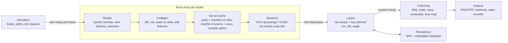

# brotkit — Design Spec

Nov 15, 2026 · @Eoin O'Brien

## Summary

Build one package (`brotkit`) that separates **iterating** a formula from **colouring** the result. A formula goes in as SymPy, gets differentiated and code-generated, and is compiled once by Numba for CPU or CUDA. A render writes a typed bundle of data layers that can be recoloured, saved and animated without re-iterating.

Goals, in priority order:

1. **Fast.** One fused kernel per render: iteration, derivatives and all orbit statistics collected in a single pass on the device. No per-iteration round-trips to Python (the PyTorch-era bottleneck).
2. **Correct by default.** Every parameter has a researched default that depends on the colouring you asked for. Smooth colouring or binary decomposition automatically raise the escape radius.
3. **Render once, colour many.** Colouring is a cheap pure function of saved layers, so you iterate a 16k image once and try 50 palettes in a notebook.
4. **Self-describing files.** Metadata goes inside the file, the filename is derived from it, and loading rebuilds the original objects.
5. **Ready for animation.** Parameter paths, 4D rotations and frame pipelines are built in, so videos aren't ad hoc.

Non-goals for v1: arbitrary-precision deep zoom (designed for, built in phase 4), 3D ray-marched fractals, and a GUI.

## Toolchain decisions

Target Python 3.15 with uv. Use Numba on the CPU and NVIDIA's `numba-cuda-mlir` package on the GPU, with float32 as the GPU default and float64 or double-float only when the zoom needs it.

| Decision | Choice | Why |
| --- | --- | --- |
| Python | 3.15, `requires-python = ">=3.14"` | [3.15.0 shipped 9 Oct 2026](https://docs.python.org/3.15/whatsnew/3.15.html). Allowing 3.14 keeps a fallback if a GPU wheel lags. |
| CPU JIT | `numba>=0.68` | [0.68 ships CPython 3.15 wheels](https://pypi.org/project/Numba/) for Linux, Windows and macOS arm64. |
| GPU JIT | `numba-cuda-mlir[cu13]==0.6.0` (NVIDIA), exact pin (ADR-0005) | The built-in `numba.cuda` was [deprecated in 0.61](https://numba.readthedocs.io/en/0.63.0/_sources/release/0.61.0-notes.rst.txt). Its successor `numba-cuda` [went into maintenance mode](https://github.com/NVIDIA/numba-cuda/issues/902) in June 2026 and won't add Python 3.15 or NumPy 2.5. `numba-cuda-mlir` ([PyPI](https://pypi.org/project/numba-cuda-mlir/)) has cp311–cp315 wheels, and spike S1 ran it on 3.14 and 3.15 with NumPy 2.5. Only `backends/cuda.py` imports it. |
| Symbolics | `sympy` | Analytic derivatives plus `pycode`/`ccode` printers drive codegen (section below). |
| Arrays | NumPy 2.x, optional CuPy for device-side colouring | Colouring stays NumPy by default. CuPy is an extra for colouring 8k+ frames on the GPU. |
| Packaging | uv project, src layout, extras `[cuda]`, `[video]`; PEP 735 dependency groups `dev`, `docs` (ADR-0001) | `uv sync --group dev --extra cuda` on the GPU box and `uv sync --group dev` on a laptop. |

**Precision is the big GPU decision.** Consumer NVIDIA cards run FP64 at [1/64 of FP32 rate (RTX 5090: 104.8 vs 1.64 TFLOPS)](https://www.techpowerup.com/gpu-specs/geforce-rtx-5090.c4216). The framework therefore has three precision tiers, picked from the view's pixel spacing:

| Tier | Type | Rough zoom limit (pixel spacing) | Where it runs well |
| --- | --- | --- | --- |
| `f32` | complex64 | \~1e-5 | GPU default: overviews, Buddhabrot, animation previews |
| `df64` | double-float (two f32s, \~48-bit mantissa) | \~1e-13 | GPU when f32 isn't enough. Ports your existing `wgsl-complex` complex128 design to Numba device functions. |
| `f64` | complex128 | \~1e-13 | GPU or CPU (all cores via `prange`) |
| `dd` | double-double (two f64s, \~106-bit mantissa) | \~1e-29 | GPU, for deep stills that don't yet justify perturbation. Each pixel is independent, so thousands of GPU threads still win even at 1/64-rate f64. FMA makes the two-product cheap. |
| `qf` | quad-float (four f32s, \~96-bit mantissa) | \~1e-26 | Optional GPU alternative to `dd` on consumer cards. It runs on the fast f32 units but needs many more operations per multiply. |
| `perturb` | f64/df64 deltas + arbitrary-precision reference orbit | unbounded | Phase 4 (see Going wide) |

Which of `dd` and `qf` is faster depends on the card's FP64:FP32 ratio, so `Precision.AUTO` decides with a one-off micro-benchmark per device and caches the result. S3 measured z²+c on an RTX 3090 Ti (1:64 FP64) at 1075 (f32), 178 (df64), 32.6 (f64) and 2.53 (dd) Giter/s: df64 is 5.5× faster than native f64 there, so on such cards AUTO should prefer df64 over f64 whenever df64's precision suffices, and qf has to beat 2.53 Giter/s to displace dd. S4 measured a qf prototype at 9–12× dd on the same card (10.8 against 1.05 Giter/s with three fused features), accurate to under 4 u (u = 2⁻⁹⁶), so qf is the likely deep tier on consumer cards; AUTO still decides per device. The CPU `dd` path stays only as a reference implementation for parity tests.

`Precision.AUTO` picks the cheapest tier for which `pixel_spacing / max(1, abs(center))` sits comfortably above that type's epsilon (three orders of magnitude of headroom), and warns when it upgrades.

Open questions:

- ~~Check `numba-cuda` cp315 wheels.~~ Resolved by S1 and ADR-0005: `numba-cuda` will never ship cp315 ([#926](https://github.com/NVIDIA/numba-cuda/issues/926)), so the GPU JIT is `numba-cuda-mlir` on 3.14 and 3.15.
- `numba-cuda-mlir` is pre-1.0 and generates code through MLIR rather than LLVM IR ([nvmath docs](https://docs.nvidia.com/cuda/nvmath-python/1.0.0/device-apis/utils.html) cover its native complex types). S3 and S4 gate the choice. **S3 passed the revised gate** ([spikes/S3.md](spikes/S3.md), ADR-0006): fastmath turned out to be inert below sm_100 and FMA contraction can't be disabled, so multi-word correctness now comes from codegen (`_rn` intrinsics plus explicit `cuda.fma`), and explicit FMA, non-contractible rounded add/mul and PTX/SASS inspection all work. **S4 passed the register half** ([spikes/S4.md](spikes/S4.md), ADR-0007): registers, spills, local memory and occupancy come from `compile_ptx` plus nvJitLink and match the driver in 175 of 175 configurations. `compile_ptx` still needs a device on 0.6.0 ([numba-cuda-mlir#492](https://github.com/NVIDIA/numba-cuda-mlir/issues/492)). Keep the backend boundary thin: only `backends/cuda.py` imports the JIT.

## Parameter names and defaults

Use `escape_radius` (always linear, never squared) and `max_iter` as the canonical names. Accept `bailout` only as an explicit alias, because tools disagree on whether it is a radius, a squared radius or an iteration cap.

In code, the escape radius lives in `Modulus(radius)`, the default `EscapeTest`. Other tests (real or imaginary part, custom conditions) take a threshold or condition instead; see the Decision log.

**The naming trap, with evidence:**

- Ultra Fractal says its "Bailout value" should be [4 or larger for the true set](https://www.ultrafractal.com/help/formulas/standard/mandelbrot.html). That only makes sense for squared modulus, so UF bailout 4 means R = 2.
- ChaosPro also defaults `bailout` to 4 but [describes it as a radius](https://chaospro.de/documentation/html/formulacompiler/languagereference/escapetime/compref_iterations_esc.htm).
- Mandelbulb3D calls it ["R Bailout"](https://kwx.liehendr.com/content/wikibooks_en_all_maxi_2021-03/A/Mandelbulb3D/Reference/Formulas/Iterations). Munafo's Mu-Ency and the academic literature say ["escape radius"](https://mrob.com/pub/muency/escaperadius.html).
- Fraktaler-3 uses `bailout.iterations` to mean [the iteration cap](https://en.wikibooks.org/wiki/Fractals/fraktaler-3), not a radius at all.

So `bailout=4` is ambiguous across tools. The framework rejects it unless `bailout_kind="radius" | "radius_sq"` is also given.

### Core vocabulary

| Canonical name | Aliases you'll see | Meaning | Default |
| --- | --- | --- | --- |
| `escape_radius` (R) | bailout, bailout radius, escape threshold, R bailout | Stop when \|z\| > R. Stored internally as `escape_radius_sq`. | Depends on the colouring (next table). Never 2 unless you ask for raw dwell. |
| `max_iter` | maximum iterations, maxiter, dwell limit, iteration limit, `bailout.iterations` | Hard cap on iterations | 1000. Auto mode scales it with log₁₀(zoom). |
| `min_iter` | minimum iterations, min escape | Discard orbits that escape too early (Buddhabrot) | 0, or 20 for Buddhabrot |
| `n` / `iterations` layer | dwell, escape time, escape count | Integer iteration at escape | output |
| `mu` layer | smooth / continuous / fractional iteration count, normalised iteration count, continuous dwell | n + 1 − log(log\|z\| / log R) / log p | output |
| `de` layer | distance estimate, DEM/M, exterior distance | Distance from c to the set boundary | output |
| `power` (p) | exponent, degree, d | Degree of the dominant term. Used in mu and DE. | 2, or the formula's leading degree from SymPy |
| `tolerance` | epsilon, convergence threshold, tol | Convergent formulas: stop when \|zₙ₊₁ − zₙ\| < tol | 1e-5 (f32), 1e-10 (f64) |
| `root_tolerance` | root match radius | Assign the converged point to a known root | 1e-3 × root separation |
| `relaxation` (a) | damping, Nova a | zₙ₊₁ = zₙ − a·f/f′ (+ c for Nova) | 1 |
| `period_epsilon` | periodicity tolerance | Interior cycle detection | 1e-12 (f64). Heiland-Allen warns loose values [give wrong periods](https://www.github.com/adammaj1/period_complex_quadratic_polynomial). |
| `stripe_density` (s) | stripe frequency | Stripe average colouring t = ½ sin(s·arg z) + ½ | 5 ([wikibooks reference code](https://en.wikibooks.org/wiki/Fractals/Iterations_in_the_complex_plane/stripeAC)) |
| `skip` | i\_skip, transient | Orbit points excluded from averages | 1 |
| `samples` | trajectories, sample count | Buddhabrot orbits drawn | 10 × pixel count for preview, 1000× for final |

### Escape radius by colouring method

Larger R costs one or two extra iterations per pixel and buys accuracy. Munafo notes it makes [dwell bands more uniform and level sets closer to true equipotentials](https://mrob.com/pub/muency/escaperadius.html).

| Colouring | Recommended R | Why |
| --- | --- | --- |
| Raw dwell (banded) | 2 | Classic look. The only case where 2 is right. |
| Smooth iteration (mu) | 1e3 (f32), 1e6 (f64) | Seams between bands shrink as R grows. A forum analysis shows they are [small at R = 5 and vanish with larger values](https://www.fractalforums.com/programming/what-rangeprecision-for-fractional-escape-counts-for-mandelbrotjulia-sets). UF users [recommend about 100](https://www.fractalforums.com/mandelbulb-renderings/higher-iterations/30). Wikibooks uses [2⁸](https://en.wikibooks.org/wiki/Fractals/color_mandelbrot). |
| Exterior distance estimate | 1e4 (f32), 1e6+ (f64) | Heiland-Allen: ["the bigger the radius, the more accurate the distance estimate"](https://kwx.liehendr.com/content/wikibooks_en_all_maxi_2021-03/A/Fractals/Iterations_in_the_complex_plane/demm), and huge values are harmless. |
| Binary / n-ary decomposition | e^π ≈ 23.14 ("square tiles") or 1e6 ("angle-accurate") | e^π gives [the most nearly square tiles](https://mrob.com/pub/muency/escaperadius.html). Large R makes tile bits [track external angles](https://mrob.com/pub/muency/externalangle.html). |
| Final angle, field lines, Böttcher | 1e6 (f64) | The argument of the last z only approximates the external angle [when R is large](https://mrob.com/pub/muency/representationfunction.html). |
| TIA / stripe / curvature averages | 1e3–1e5 | They need the smooth fraction to interpolate between the last two partial sums. |
| Buddhabrot | 2 | Only escape matters. Larger R just adds off-screen orbit points. |

**The f32 overflow budget.** At escape, the last |z| can be about R², so |z|² is about R⁴, which must stay below 3.4e38. That caps R near 1e9 in f32. The running derivative grows much faster, so in f32 the DE kernel tracks log|dz| (or rescales dz each iteration) instead of dz itself. The defaults above respect this; `Precision` validation raises an error if you exceed it.

### Distance-estimate convention

Two formulas circulate, a factor of 4 apart:

```latex
d_{\text{est}} = \frac{2\,|z_n|\,\ln|z_n|}{|z_n'|} \qquad d_{\text{lower}} = \frac{|z_n|\,\ln|z_n|}{2\,|z_n'|}
```

The first is [Munafo's and Heiland-Allen's](https://mrob.com/pub/muency/distanceestimator.html). The second is the [Koebe ¼ lower bound](https://blog.hvidtfeldts.net/index.php/2011/09/distance-estimated-3d-fractals-v-the-mandelbulb-different-de-approximations/) used for safe ray-marching. Expose `de_convention="estimate" | "lower_bound"` and record it in metadata. The default is `estimate` for 2D and `lower_bound` for anything you march. Derivative seeds: Mandelbrot `dc = 0` with z₀ = 0, Julia `dz = 1`. Colouring normalises by pixel spacing, for example `tanh(d / pixel_spacing)`.

## Fractal families

Everything reduces to three kernel families that differ in stopping rule and output shape. Each family is one generated kernel template, and individual fractals are just formulas plugged into it. A formula can also be a holomorphic FormulaSequence (see Decision log).

| Family | Stops when | Output shape | Examples |
| --- | --- | --- | --- |
| `EscapeTime` | the EscapeTest fires (default \|z\| > R), or a cycle is detected, or `max_iter` | per-pixel layers | Mandelbrot, Julia, Multibrot, Burning Ship, Tricorn, any SymPy f(z, c) |
| `Convergent` | \|zₙ₊₁ − zₙ\| < tol, or \|z\| > R, or `max_iter` | per-pixel layers + root index | Newton, Halley, Householder, Nova, Magnet I/II |
| `Density` | any per-sample rule (escape window, non-escape) | accumulated histograms | Buddhabrot, anti-Buddhabrot, Nebulabrot, Julia orbit density, inverse iteration (MIIM), strange attractors |

Trajectories aren't a family. `trace_orbit(formula, seeds, n)` runs on the CPU and returns polylines in the view's coordinates, so they can be drawn over any rendered image.

### EscapeTime

- **Exterior layers:** `n`, `mu`, final z (angle for binary/n-ary decomposition, Böttcher-style final angle), `de`, and running orbit statistics: stripe average, TIA, curvature average, min/max |z|, orbit-trap distances.
- **Interior layers:** period from Brent cycle detection (cheaper than storing history on the GPU), attractor multiplier |λ| (interior coordinate), atom-domain index (iteration of minimum |z|), and interior distance estimate. Interior DE needs the period plus second derivatives (∂z/∂z, ∂²z/∂z², ∂²z/∂z∂c), and SymPy generates those for free. Method after [Heiland-Allen](https://www.github.com/adammaj1/period_complex_quadratic_polynomial) and [Munafo](https://mrob.com/pub/muency/interiordistanceestimate.html).
- **Shortcuts:** analytic cardioid and period-2 bulb rejection for z² + c, only when the formula is exactly that.

### Convergent (Newton and friends)

- The test is step size, not distance to a known root, so formulas with unknown roots still work. Roots are identified afterwards: from SymPy `nroots` when the function is polynomial, otherwise by clustering converged endpoints. The result is a `root_id` layer plus a `roots` table in metadata.
- **Smooth convergence**, the analogue of mu: with δₙ = |zₙ − zₙ₋₁| and convergence order q (2 for simple roots), mu = n + 1 − log(log(1/δₙ) / log(1/tol)) / log q.
- **Multiple roots** converge only linearly, which breaks that formula. Read multiplicity from SymPy and either switch to the modified Newton step (f/f′ × m) or fall back to q = 1 with a log-step fraction.
- **Hybrids** (Nova, Magnet) can both converge and escape. The kernel tests both and writes an `outcome` layer: 0 = escaped, 1 = converged, 2 = cycle, 3 = hit `max_iter`. Value 4 marks a numeric failure (see Phase 1 decisions). Colouring dispatches on it.
- Guard against division by zero: if |f′| < 1e-14 (f64), stop with outcome 3, matching [common practice](https://kwx.liehendr.com/content/wikibooks_en_all_maxi_2021-03/A/Fractals/Mathematics/Newton_method).

### Density (Buddhabrot)

- **Two passes per sample, no orbit storage:** iterate to classify (escaped? in which iteration window?), and if accepted, re-iterate and splat. This keeps GPU registers flat and uses `cuda.atomic.add` into `uint32` histograms (atomic add supports int32/int64/float32/float64 [per the kernel API](https://numba.readthedocs.io/en/0.55.0/cuda-reference/kernel.html)). On overflow risk, switch to `uint64` with the atomic add on the int64 view.
- **Channels are escape windows**, not just max\_iter. Green's original nebula mapping used [thresholds of 500, 5000 and 50000 for blue, green and red](https://superliminal.com/fractals/bbrot/). A `min_iter` cut sharpens the image ([David Aramant's write-up](https://davidaramant.github.io/post/the-buddhabrot-part-2)). Config is a list of `(min_iter, max_iter)` windows, one histogram each, with no hard RGB assumption.
- **4D view:** sample (z₀, c) ∈ ℂ² and project each orbit point (zₙ, c) onto the view's Embedding plane, (u, v) = ((p − origin)·e₁, (p − origin)·e₂). Axis-aligned projections give the [six major planes](https://superliminal.com/fractals/bbrot/), including the plane where the logistic map appears. Arbitrary rotations give the animation case.
- **Sampling strategies** (pluggable): uniform in the R = 2 disc; importance map (accumulate per-start contribution, then sample from it); Metropolis-Hastings per [Boswell](https://quuxplusone.github.io/blog/2021/07/27/buddhabrot). Default to the importance map for animation, because MH samples are correlated, which gives ["splotchy" noise that is hard to animate](https://dotat.at/:/4NBGV). Offer MH for deep stills.
- **Determinism:** a counter-based RNG (Philox, keyed by sample index and seed) so any frame or tile can be regenerated bit-identically.

## Formula pipeline: SymPy to kernel

Formulas are SymPy expressions. The framework differentiates them, lowers them to explicit real arithmetic, splices them into a family template along with the requested accumulator features, writes the result to a cached `.py` file, and JIT-compiles that file. Composition happens at code-generation time, so the kernel that runs has no indirection at all.

```python
import sympy as sp
from decimal import Decimal
from brotkit import Formula, Frame, View, render   # View = Frame + Embedding (Mandelbrot plane by default)
from brotkit.features import Smooth, DistanceEstimate, BinaryDecomp, StripeAverage

z, c, p, k = sp.symbols("z c p k", complex=True)
f = Formula(z**p + k * z**2 + c, params={"p": 3, "k": 0.1 + 0.05j}, kind="mandelbrot")

result = render(
    f,
    View(frame=Frame(center=(Decimal("-0.5"), Decimal("0")), width=Decimal("3.2"), pixels=(3840, 2160))),
    features=[Smooth(), DistanceEstimate(), BinaryDecomp(arity=4), StripeAverage(density=5)],
    backend="cuda", precision="auto",
)   # escape_radius auto-picked: max of each feature's requirement, within the precision's budget
```

**Stages:**

1. **Analyse.** Find the leading degree (sets `power`) and the critical points via `solve(diff(f, z), z)`. That gives z₀ for the parameter plane. A formula with several critical points becomes several renders, or one chosen with `critical_point=i`. Test holomorphy with the Cauchy-Riemann equations on the real/imaginary split.
2. **Differentiate.** Exterior DE uses z′ ← f\_z·z′ + f\_c (parameter plane) or z′ ← f\_z·z′ (Julia). Interior DE adds f\_zz and f\_zc. Non-holomorphic formulas (Burning Ship, Tricorn) get a 2×2 Jacobian instead of a complex derivative, and DE uses its operator norm.
3. **Lower to reals.** Split every complex variable into an (x, y) pair, run `sympy.cse` over the whole step plus derivatives, and print with a custom `RealPairPrinter`. Integer powers become squaring chains. Non-integer or symbolic powers become polar exp/log, with a warning about the branch-cut seam. Explicit reals are what make the `f32` and `df64` tiers possible: `df64` swaps the printer's `+ − ×` for two-sum/two-product device-function calls, and the dd printer emits the same error-free transformations over f64 pairs (FMA-based two-product), so both tiers come from one lowering pass.
4. **Assemble.** The family template has slots (`init`, `step`, `escape_test`, `per_iter`, `finalise`). Each feature contributes code to those slots and declares its output layers and dtype. Features are compile-time mix-ins, never runtime virtual calls.
5. **Compile and cache.** Look the kernel up in brotkit's kernel cache under a sha256 of the source, the entry name and signature, every compile option that changes the binary (fastmath, `max_registers`, launch bounds, lineinfo, debug, opt, ptxas and nvJitLink options), the target cc, and the Python, numba-cuda-mlir, libNVVM, nvJitLink and NumPy versions (ADR-0008). On a miss, write the generated source to a real `.py` file in the cache (inspectable, and tracebacks have a file to point at), import it, compile it to PTX with Numba (`numba.njit(parallel=True)` on the CPU), link a cubin with nvJitLink and store the cubin, the PTX, the entry symbol, the launch signature and the `ResourceUsage` as one entry. A hit loads the cubin with `cuda.core` without importing Numba: milliseconds in a fresh process, against 0.2–2.5 s cold (S2). brotkit never uses Numba's `cache=True`: its key ignores `max_registers`, `ptxas_options`, `lineinfo`, `opt` and the function's constants (S2, S4, [#493](https://github.com/NVIDIA/numba-cuda-mlir/issues/493)). Kernels use a raw-pointer ABI: typed device pointers plus `int64` shapes, strides and counts (ADR-0008).

**Runtime parameters vs specialisation.** Parameters are kernel arguments by default, so animating `k` never recompiles. `specialize={"p": 3}` bakes a value in, so integer powers unroll and constants fold. Use it for stills, and automatically for `p` when it is an integer.

**Inspectability.** `f.compile(...).source` returns the generated Python, `.ptx` the PTX, and `.explain()` the derivative expressions. Debugging generated kernels without these is miserable.

## Render once, colour many

Store a small set of raw layers that can't be recomputed, and derive everything else lazily. With iteration count, final z and log|z′| you can recolour as smooth, decomposition, potential, angle or DE without touching the kernel again.

| Layer | dtype | Recomputable? | Feeds |
| --- | --- | --- | --- |
| `n` | uint32 | no | dwell, mu, potential, histogram colouring |
| `outcome` | uint8 | no | inside/outside/converged/cycle masks |
| `z_final` | complex64/128 | no | mu, binary and n-ary decomposition, final angle, potential |
| `log_dz` | float32 | no | exterior DE (with `z_final`), DE-based shading, normals |
| `arg_dz` | float32 | no | 2D "normal map" / emboss lighting angle |
| `stripe_s`, `stripe_s_prev` | float32 | no | stripe average (needs both sums to interpolate with mu) |
| `tia_s`, `tia_s_prev` | float32 | no | triangle-inequality average |
| `trap_d`, `trap_n` | float32, uint32 | no | orbit traps (distance, iteration where it was hit) |
| `period`, `lambda_abs`, `atom_n`, `de_interior` | uint16, f32, uint32, f32 | no | interior colouring |
| `root_id`, `delta_n`, `delta_prev` | uint8, f32, f32 | no | Newton basin + smooth convergence |
| `mu`, `decomp(k)`, `angle`, `potential`, `de` | float32 | **yes** | lazy, memoised properties on `Layers` |

Features are opt-in because memory adds up. At 3840×2160 each float32 layer is 33 MB, so the full interior-plus-exterior set is about 0.5 GB before supersampling.

**The colouring pipeline** is a chain of small pure functions over NumPy (or CuPy) arrays:

1. **Field:** pick or derive a scalar (`mu`, `de / pixel`, `stripe(mu)`, `angle / 2π`).
2. **Transform:** normalise (min/max, percentile, or a fixed range so animation frames match), then log, power, histogram-equalise, or modulo/cycle.
3. **Ramp:** scalar to linear RGB(A) (next section).
4. **Composite:** several fields combined with masks and blend modes, for example hue from `mu`, value from `tanh(de)`, interior from `lambda_abs`. Also lighting from `arg_dz`.
5. **Output:** tone map, apply the sRGB transfer function, quantise to 16 bits, or to 8 bits with blue-noise dithering.

**Anti-aliasing happens after colouring.** Supersampled renders keep per-sample values in a `SampleStore`, and colouring filters coloured samples in linear RGB (see Sampling and anti-aliasing). Averaging `mu` or `n` before colouring is wrong at band edges and filaments, so it exists only as the labelled `aa="field"` preview mode.

**Global statistics** (histogram CDF, percentiles) are cached on `Layers` per field. Animation can pin them from a keyframe (`stats=frame0.stats`) so the colours don't flicker.

## Sampling and anti-aliasing

Pixels are square areas sampled at their centres. The default is adaptive scrambled-Sobol supersampling at 4–64 samples per pixel. Every sample is coloured, then filtered in linear light with a Mitchell–Netravali filter. Samples are stored sparsely so recolouring keeps correct anti-aliasing.

### Pixel grid convention

Pixel (i, j) covers \[i, i+1) × \[j, j+1) in pixel units, and its plain sample sits at its centre. With W × H pixels, pixel spacing s = width / W and frame centre (cᵤ, cᵥ):

```latex
u = c_u + \left(i + \tfrac12 - \tfrac{W}{2}\right)s \qquad v = c_v - \left(j + \tfrac12 - \tfrac{H}{2}\right)s
```

- **The frame centre is the image centre.** For even sizes it lands on a pixel corner shared by four pixels. That's intended: a k×k grid supersample is then exactly a k× render, previews and finals cover identical regions, tiles join without half-pixel seams, and symmetric views stay exactly symmetric.
- **Row 0 is the top and the imaginary axis points up** (the minus sign above). Arrays save as images without flips and match Matplotlib's `imshow(origin="upper")`.
- **No pixel-anchor option.** To put a point exactly on a pixel centre, use an odd dimension or offset the centre by half a pixel explicitly.

### Strategies

| Strategy | Samples/px | Character | Use |
| --- | --- | --- | --- |
| **Adaptive scrambled Sobol** (default) | 4–64 | Progressive low-discrepancy pattern. Refines where DE < 2 px or colour variance across samples is high. Roughly 5–20× cheaper than uniform 64×. | finals and stills |
| Regular grid k×k | k² | Same as a k× render via the plain kernel. Can show moiré on dwell bands and spirals. | fallback, cheapest storage |
| Rotated grid (RGSS) | 4 | Much better than a 2×2 grid on near-axis-aligned edges | cheap good option |
| Quincunx | 5 (effectively 2: corners shared) | Corner lattice computed once plus centres. Slightly soft. | previews, animation drafts |
| Jittered / stratified | k² | Turns aliasing into fine noise | general use |
| Poisson disk / blue noise | n | Least visible noise for fixed n. Precomputed tile with a per-pixel Cranley–Patterson shift. | fixed-budget finals |
| Halton (2,3), R2 | n | Progressive alternatives to Sobol | comparison, research |
| Uniform random | n | Slowest convergence | tests only |

The minimum of 4 samples stops thin filaments hiding between samples. The DE criterion acts as a free edge detector: pixels far from the boundary stay at the minimum.

### How it fits Frame and Embedding

- `Embedding` is unchanged: it maps the plane to (z₀, c) and knows nothing about pixels.
- `Frame` gains `sampling: PixelSampling`, a frozen value object (strategy, min/max samples, refinement thresholds, seed, filter).
- The kernel computes `frame.to_plane(i + ox, j + oy)` and then the embedding. Offsets come from a shared pattern plus a per-pixel scramble seeded by `hash(i, j, seed)`, so results are deterministic and independent of tiling.
- Regular grids skip the offset machinery and render a k× larger `Frame`.
- Adaptive rendering is two passes: a minimum-samples pass over every pixel, then a refinement pass over a compacted list of the pixels that need more. Compaction also improves GPU warp coherence, because the expensive boundary pixels run together.

```python
class Strategy(StrEnum):
    ADAPTIVE_SOBOL = "adaptive_sobol"; GRID = "grid"; RGSS = "rgss"; QUINCUNX = "quincunx"
    JITTERED = "jittered"; BLUE_NOISE = "blue_noise"; HALTON = "halton"; R2 = "r2"; RANDOM = "random"

class Filter(StrEnum):
    MITCHELL = "mitchell"; BOX = "box"; TENT = "tent"; GAUSSIAN = "gaussian"
    BLACKMAN_HARRIS = "blackman_harris"; LANCZOS3 = "lanczos3"

@dataclass(**FROZEN)
class PixelSampling:
    strategy: Strategy = Strategy.ADAPTIVE_SOBOL
    min_samples: int = 4
    max_samples: int = 64
    refine_de_px: float = 2.0             # refine where DE < this many pixels
    refine_variance: float = 1e-3         # linear-RGB variance threshold
    filter: Filter = Filter.MITCHELL
    filter_radius_px: float = 2.0
    seed: int = 0
    vary_per_frame: bool = False          # animation: fixed pattern by default
```

### What gets averaged

**Coloured samples, in linear light.** A pixel's value is the integral of colour over its area, so each sample is coloured first and the colours are then averaged.

- **Colour maps are nonlinear.** A filament pixel with samples at mu = 40 and mu = 4000 averages to 2020, a colour found nowhere in that pixel. The same goes for decomposition, angle and stripe phases, wrap-mode ramps and DE shading.
- **Interior samples have no escape time**, so a half-inside pixel has no meaningful mean mu.
- **Even smooth regions shift slightly:** ramp(E\[mu\]) only equals E\[ramp(mu)\] where the ramp is locally linear.
- **Gamma matters.** Averaging sRGB-encoded values darkens edges and thins bright filaments. Ramps output linear RGBA. Matplotlib maps are stored sRGB-encoded, so their LUTs are converted to linear when baked. Use the real sRGB transfer function, not a 2.2 power or a square.
- **Order:** colour each sample → filter and average in linear light → tone-map and clip → sRGB-encode → quantise. Lighting and HDR compositing happen before clipping.

Where averaging the underlying value is legitimate:

- **Buddhabrot density** is already an integral. More samples means more splats, and the filter applies to the splats.
- **DE coverage:** for boundary-only renders, coverage = clamp(½ − d/s) gives analytic anti-aliasing from one sample.
- **Histogram colouring statistics** are computed over weighted samples, not pixels.
- **`aa="field"` preview mode** averages the field before colouring. It is fast for scrubbing palettes and labelled approximate in the UI and metadata.

### SampleStore: keeping recolouring correct

Correct anti-aliasing needs per-sample values at colouring time, but storing every sample costs n× memory (about 530 MB per float32 layer at 4K with 16 samples per pixel). `SampleStore` keeps:

- a **dense layer** with one representative sample per pixel, which is enough for pixels whose samples barely differ;
- a **sparse block** with every sample (offsets plus raw layer values) for pixels the adaptive pass refined, in CSR form: one start offset per pixel into flat arrays.

Refined pixels are typically 5–15% of an image, so storage is a small multiple of a 1× render rather than n×. Colouring evaluates every stored sample, splats it through the filter, and normalises by the summed weights. The same NPZ schema stores it, with `__meta__` recording the sampling config.

### Reconstruction filter

- **Default: Mitchell–Netravali, B = C = ⅓, radius 2 px.** Crisp with little ringing, and less aliasing than a box.
- Alternatives: box (crispest, each pixel averages only its own samples), tent, Gaussian, Blackman–Harris (softest, no ringing), Lanczos-3 (sharpest, rings on hard fractal edges).
- Implementation: accumulate Σw·colour and Σw per pixel. On the GPU use a gather over neighbouring pixels' samples rather than atomics wherever the pattern allows. Mitchell has small negative lobes, so clamp the result to zero before encoding.
- **Tiles need an apron** as wide as the filter radius (2 px by default), so tile boundaries are invisible.

### Animation

The sample pattern is fixed across frames by default, so static regions don't shimmer. Set `vary_per_frame=True` only when accumulating samples over time for motion blur or feeding a temporal denoiser.

## Colour ramp system

A `Ramp` is an immutable expression tree that maps t ∈ \[0, 1\] to linear RGBA. Concatenation, reversal, repetition and phase are tree nodes. The tree is baked into a 4096-entry float32 LUT for evaluation, but serialised as the tree, so a saved image records how its palette was built.

```python
from brotkit.colour import Ramp, Scale

fire  = Ramp.from_mpl("inferno")
ice   = Ramp.from_stops(["#00121f", "#2a7fb8", "#e8f6ff"], space="oklab")
duo   = Ramp.concat([(fire, 0.6), (~ice, 0.4)])         # end to end, ice reversed, 60/40 split
pal   = duo.repeat(3.5, mode="mirror").shift(0.12)      # fwd-back-fwd-back for 3.5 cycles, phase 0.12
img   = result.colour(field="mu", scale=Scale.log(offset=1), ramp=pal)
```

| Operation | Spelling | Definition (u = input) |
| --- | --- | --- |
| Reverse | `~r`, `r.reversed()` | r(1 − u) |
| Concatenate | `r1 + r2`, `Ramp.concat([(r, w), …])` | piecewise over cumulative weights |
| Repeat (wrap) | `r.repeat(n)` | r(frac(n·u)), with u = 1 mapping to r(1) |
| Repeat (mirror / ping-pong) | `r.repeat(n, mode="mirror")` | r(tri(n·u)), tri(x) = 1 − \|(x mod 2) − 1\| |
| Fractional repeats | any non-integer n | the last cycle stops part-way. Mirror stays continuous, wrap has one seam. |
| Phase / palette cycling | `r.shift(φ)` | r(frac(u + φ)). Animating φ is classic palette cycling. |
| Sub-range | `r[0.2:0.8]` | r(0.2 + 0.6·u) |
| Blend | `r1.mix(r2, w)` | mixed in OKLab |

**Scales act on the field, not the ramp.** `Scale` transforms the scalar field before normalisation, so a log scale on `mu` and a log scale on `de` mean what you'd expect. Built-ins: `linear`, `log(offset)`, `power(γ)`, `sqrt`, `symlog(linthresh)`, `asinh`, `histogram()` (CDF equalisation), and `cycle(period)` for unbounded fields such as `mu`, where you want a ramp repetition every k iterations independent of `max_iter`.

**Interpolation space** is per ramp: `srgb` (matches Matplotlib), `linear`, `oklab` (default for user stops), or `oklch` with shortest-arc hue. OKLab is approximately perceptually uniform, so [equal steps look equally different](https://alecjacobson.com/weblog/large-colorful-circles-oklab-vs-rgb.html) and blends don't drift through muddy greys.

**Sources:** Matplotlib's registry, `colorcet` (well-designed cyclic maps for angle fields), and stop lists or `.ggr`/`.map` gradient files (Gimp, Fractint), for reusing old palettes.

**Guards:** warn when a non-cyclic ramp in wrap mode is used on a periodic field (`angle`, `decomp`), since it will show a seam. Suggest mirror mode or a cyclic map instead. For very high repeat counts, offer `fade_by_de=True` so dense filaments fade toward a mean colour rather than aliasing into noise.

**Serialisation** stores the tree as JSON plus the baked LUT, so an image recoloured years later matches even if Matplotlib changes a map.

## Persistence: files, metadata, naming

Use compressed NPZ with the metadata embedded as a JSON entry, load with `allow_pickle=False`, and derive filenames from the metadata without ever parsing them back. Pickle is supported only for in-process use (multiprocessing, caching), never as the archive format: unpickling runs arbitrary code and breaks when classes are refactored.

**File kinds:**

| Kind | Suffix | Contents |
| --- | --- | --- |
| Layers | `.layers.npz` | raw layers + `__meta__` |
| Density | `.density.npz` | uint32/uint64 histograms per channel + `samples_drawn` + RNG state. Resumable: two files with the same recipe add together. |
| Recipe | `.recipe.json` | formula + view + features + precision, everything needed to re-render, no arrays |
| Palette | `.palette.json` | Ramp tree + baked LUT |
| Image | `.png` / `.tiff` (16-bit) | pixels + PNG `iTXt` chunk holding the recipe, palette and source layer hash |
| Interop (optional) | `.exr` | layers as EXR channels with a metadata header, the way [Fraktaler-3 and Kalles Fraktaler](https://en.wikibooks.org/wiki/Fractals/fraktaler-3) export |

**Embedded metadata** (`__meta__`, stored as a uint8 array of UTF-8 JSON):

- `schema`: `"brotkit/layers"`, `schema_version`, `type` (registry key such as `"EscapeTimeResult"`), `type_version`.
- Provenance: `brotkit` version, git SHA if dirty-checked, Numba and numba-cuda-mlir versions, device name, created timestamp (UTC), wall time.
- Formula: a JSON expression tree restricted to whitelisted node types (see Phase 1 additions), plus LaTeX and `str` for humans, and the params. Never `srepr`, which needs `eval` to load.
- View: **centre and width as decimal strings**, not floats, so deep-zoom coordinates survive; plus pixels, rotation, the PixelSampling config, and the Embedding (origin and basis vectors).
- Numerics: precision tier, `escape_radius`, `max_iter`, `de_convention`, feature list with their params, RNG seed and sampler (density).
- Layer manifest: name, dtype, shape, meaning, and a sha256 of each array.

**Class registry and safe loading.** Result classes register with `@register("escape_time", version=2)`. `brotkit.load(path)` reads `__meta__` first, looks up `type` in the registry, runs `migrate(meta, from_version)` hooks if needed, and builds the object. No class name from the file is ever imported dynamically, so a malicious file can't choose code to run.

**Naming scheme**, generated by each class's `default_filename()`:

```
{family}-{formula_slug}_{centre}_{width}_{W}x{H}_{precision}_{hash8}.{kind}.npz
mandelbrot-z2+c_-0.743643+0.131825j_w3.2e-03_3840x2160_f64_9f2c1a7b.layers.npz
```

`hash8` is the first 8 hex digits of the sha256 of the canonical recipe JSON, so identical renders share a name and dedupe naturally. Names are for humans and sorting only. If a loaded file's name-hash disagrees with its embedded recipe, `load` warns that it was renamed or edited, but trusts the metadata.

**Large renders:** NPZ is a zip, so loading reads whole arrays. Above about 4 GB, or for tiled poster renders, the same schema writes to Zarr (one array per layer, chunked by tile, metadata in `.zattrs`). It sits behind the same `save`/`load` calls, selected by suffix.

## Animation and video

An animation is a `Recipe` plus `Track`s that vary any of its fields over time. A frame pipeline renders, colours and encodes concurrently, and can keep every frame's layers so a finished animation can be recoloured without re-rendering.

### Tracks and interpolation

- **Any recipe field is animatable:** formula params, view centre/width/rotation, escape windows, palette phase, colour-scale stats, even feature params such as stripe density. Tracks hold keyframes with per-segment easing (linear, cubic, Catmull-Rom, ease-in/out).
- **Zoom is interpolated in log(width)**, so the zoom speed looks constant. A combined pan-and-zoom should use the van Wijk–Nuij optimal path (zoom out, pan, zoom in) rather than lerping the centre.
- **Complex parameters follow paths, not lerps.** `Path.circle(r, θ₀, θ₁)`, `Path.cardioid(θ)` (c = e^{iθ}/2 − e^{2iθ}/4, the classic boundary-walk for Julia morphs), `Path.bezier`, and `Path.from_points` with arc-length reparametrisation so speed stays even.

### 4D slices and rotations

- **One model for Mandelbrot, Julia and everything between:** a 2D slice through (z₀, c) ∈ ℂ² ≅ ℝ⁴ given by an origin and two orthonormal 4-vectors e₁, e₂. Each pixel is origin + u·e₁ + v·e₂. The Mandelbrot set is the slice z₀ = 0, a Julia set is c = const, and anything else is an oblique slice.
- **DE on oblique slices:** seed the derivative with the slice direction, z′₀ = (e₁'s z₀-part) and dc = (e₁'s c-part). The SymPy step then carries both ∂/∂z₀ and ∂/∂c terms, so the exterior DE stays valid on any slice.
- **Rotations** are composed from Givens rotations in the six planes (zᵣzᵢ, zᵣcᵣ, …). Interpolation uses the SO(4) double cover: each rotation is a pair of unit quaternions (left, right), slerped independently. That gives smooth, constant-speed 4D rotations without gimbal effects.
- **Buddhabrot** projects orbit points onto the same Embedding plane the rotation produces, so "rotate the Buddhabrot through 4D" and "tilt the Mandelbrot slice" share code and keyframes.

### Frame pipeline

1. A frame generator yields recipes.
2. The render stage (GPU) fills layers.
3. The colour stage (CPU or CuPy) runs the pipeline with pinned stats.
4. An encoder stage receives frames.

Stages are joined by bounded queues on threads. Numba and CUDA calls release the GIL, and free-threaded 3.14t/3.15t builds can be tried later. Every frame has a deterministic index, so a crashed run resumes from the last completed frame.

**Layer retention:** `keep="none" | "keyframes" | "all"`. At 4K, `all` costs about 100 MB per frame, so a minute at 60 fps is about 360 GB. Store `n` as uint32 and only the *fractional* part of `mu` as float16, rather than `mu` itself as float16, which loses precision at high iteration counts. Do the same for log-scaled DE.

**Encoding** goes through PyAV (FFmpeg bindings), with a raw `ffmpeg` pipe as fallback:

| Target | Codec / format | Notes |
| --- | --- | --- |
| Sharing | H.265 or H.264, 10-bit | 10-bit avoids banding in smooth gradients. NVENC when present. |
| Master | FFV1, ProRes 4444, or a 16-bit PNG/TIFF sequence | 4:4:4. 4:2:0 chroma subsampling smears thin coloured filaments. |
| Preview | H.264 8-bit, half resolution, f32 | fast iteration in notebooks |

**Temporal quality:** subframe accumulation for motion blur, and DE-based fading of sub-pixel filaments to stop them flickering frame to frame.

**Exponential-map zooms.** For pure zoom-ins, render one log-polar (Mercator) strip of the whole zoom and reproject each frame from it. It is far cheaper than rendering every frame, and is the approach behind [kf-extras' exponential map tools and zoomasm](https://en.wikibooks.org/wiki/Fractals/kf-extras). Provide `ExpMapRender` and `frames_from_expmap()`.

## Iteration folding views (phase 3)

brotkit can show how each iteration stretches and folds the plane, in two views. A pull-back colours each pixel by a texture sampled where the pixel lands after k steps. A push-forward moves textured samples forward and splats them where they land. Animation between steps uses a staged homotopy built from the formula's SymPy expression tree.

### Pull-back (per pixel)

- Each output pixel w is coloured by `texture(fᵏ(w))`. For Julia views w = z₀. For the Mandelbrot plane w = c and the texture is sampled at zₖ(c). It shows the plane wrapping around itself 2ᵏ times as k grows.
- It runs in the escape-time kernel as a `FoldSnapshot(steps=(0, 1, 2, …))` feature that stores zₖ and log|dzₖ/dw| for each requested k. Texturing happens at colour time, so one render supports any texture: render once, texture many.
- **Anti-aliasing comes from the derivative.** A pixel's footprint in texture space is |dzₖ/dw|·s, and the kernel already tracks that derivative. Colouring uses it to pick a mip level (pre-blurred texture), which stops the 2ᵏ-fold detail from aliasing. It composes with `PixelSampling` for the remaining edges.
- **Texture coordinates:** `plane` (texture laid on the z-plane, good for small k and Julia interiors) or `log_polar` (coordinates (log|z|, arg z)). In log-polar coordinates squaring is an exact scale by 2 in both axes, so escaping regions tile cleanly instead of smearing. Default: `log_polar` for exterior points, `plane` inside.

### Push-forward (per sample)

- Samples are scattered over the source plane (jittered or Sobol, seeded with Philox, a few per pixel). Each carries its source texture colour and is moved by fᵏ, then splatted into the output plane with the reconstruction filter.
- It reuses the Density family's splatting and atomics. Accumulators hold ΣRGBA and a hit count, giving two layers: `colour` (the average carried colour) and `multiplicity` (how many source samples landed per pixel, which shows the 2ᵏ-to-1 folding and where area concentrates).
- Grid lines can also be pushed forward as densely sampled polylines and splatted, so folds appear as creases in a mapped grid.
- Samples that escape past R are dropped and counted. The escaped fraction per step is recorded in metadata.

### Animating between steps: staged homotopy

There is no canonical "half iteration" of z² + c. brotkit instead breaks the step into the elementary operations of the formula's SymPy expression tree and animates each with its own parameter t ∈ \[0, 1\]:

| Operation in the tree | Stage | Continuous form |
| --- | --- | --- |
| zⁿ (integer n) | `PowerStage(n)` | polar: radius r^(1 + (n−1)t), angle (1 + (n−1)t)θ. The angle multiplication *is* the fold. |
| a·z (constant a) | `ScaleRotateStage(a)` | multiply by aᵗ in polar form, a smooth rotation and scaling |
| z + c | `TranslateStage(c)` | z + t·c |
| anything else | `GenericStage(expr)` | straight-line fallback (1 − t)·x + t·g(x) |

- For z² + c, one iteration is `PowerStage(2)` then `TranslateStage(c)`. A track parameter `fold.k` runs continuously, with an integer part for the step and a fractional part for the stage progress, weighted by stage duration.
- **The seam is the fold.** Angle interpolation needs a branch, so brotkit uses arg ∈ (−π, π\]. During a power stage the image tears along the negative real axis: that is where the plane is being folded over itself. It is drawn as an optional labelled fold-line overlay rather than hidden.
- Pull-back evaluates the staged map per pixel at each frame. Push-forward moves samples continuously through the stages, which is the more intuitive view for showing folding in motion.

### Textures

Built-ins: `Checkerboard(n)`, `PolarGrid(rings, spokes)`, `DomainColouring(contours=True)` (arg → hue, log|·| contour lines), and `ImageTexture(path)` for any image. Images are converted to linear Rec.2020, mipmapped once, and stored by content hash so recipes stay reproducible.

```python
@dataclass(**FROZEN)
class Texture(ABC):
    kind: ClassVar[str]
    @abstractmethod
    def sample(self, u: np.ndarray, v: np.ndarray, lod: np.ndarray) -> np.ndarray: ...   # -> linear RGBA

@dataclass(**FROZEN)
class Checkerboard(Texture): n: int = 8
@dataclass(**FROZEN)
class PolarGrid(Texture): rings: int = 8; spokes: int = 16
@dataclass(**FROZEN)
class DomainColouring(Texture): contours: bool = True
@dataclass(**FROZEN)
class ImageTexture(Texture):
    path: str
    sha256: str                                   # pinned in metadata; the mip pyramid is cached by hash

@dataclass(**FROZEN)
class Stage(ABC):
    weight: float = 1.0                           # share of the step's animation time
@dataclass(**FROZEN)
class PowerStage(Stage): n: int
@dataclass(**FROZEN)
class ScaleRotateStage(Stage): a: complex
@dataclass(**FROZEN)
class TranslateStage(Stage): c: complex | str     # str = a formula parameter name, e.g. "c"
@dataclass(**FROZEN)
class GenericStage(Stage): expr: sp.Expr

@dataclass(**FROZEN)
class Homotopy:
    stages: tuple[Stage, ...]
    @classmethod
    def from_formula(cls, f: Formula) -> Self: ...    # walks the SymPy tree in evaluation order

@dataclass(**FROZEN)
class FoldView:
    mode: Literal["pullback", "pushforward"]
    k: float                                      # integer part = step, fraction = stage progress
    texture: Texture = DomainColouring()
    texture_space: Literal["auto", "plane", "log_polar"] = "auto"
    homotopy: Homotopy | None = None              # None = Homotopy.from_formula(recipe.formula)
    samples_per_pixel: int = 4                    # push-forward only
    fold_line_overlay: bool = False
```

## Architecture

Use objects for configuration and data, and generated code for the hot loop. Every abstraction lives above the kernel boundary. Below it there is only one flat, specialised function per (formula, features, precision, backend).



The top row runs once per render and the bottom row as often as you like. The only arrow between them is the layer bundle.

### Package layout

```
src/brotkit/
  core/        View, Precision, Recipe, registry, hashing
  formula/     Formula, analysis (degree, critical points, holomorphy), zoo/
  codegen/     printers (RealPair, DF64), templates/ (escape, convergent, density), features/, cache
  backends/    cpu.py (njit+prange), cuda.py (numba-cuda-mlir; the only importer, ADR-0005), launch geometry, tiling
  layers/      Layers, lazy derived fields, stats
  sampling/    PixelSampling, sample patterns (Sobol, blue noise, ...), SampleStore, reconstruction filters
  colour/      Ramp, Scale, interpolation spaces, compositing, lighting, io (ggr/map)
  density/     samplers (uniform, importance, MH), Philox RNG, projections
  numerics/    period, nucleus, rays, Misiurewicz (phase 3)
  anim/        Track, Path, Rotation4 (SO(4) quaternion pairs), pipeline, encoders
  fold/        FoldView, Homotopy and stages, textures (phase 3)
  io/          npz, zarr, png metadata, exr
  widgets/     Jupyter explorer
```

### Patterns used, and where

| Pattern | Where | Why |
| --- | --- | --- |
| Immutable value objects (frozen dataclasses) | `View`, `Recipe`, `Ramp`, `Scale`, feature configs | hashable, so they work as cache keys and serialise trivially. `replace()` gives cheap variants for animation. |
| Template + mix-ins at codegen time | kernel families + features | Composition without runtime dispatch. This is the key to reuse without slowness. |
| Strategy | backends, samplers, precision printers, encoders | swappable behind a small protocol (`typing.Protocol`), chosen once per render, not per pixel |
| Registry | result types, features, formulas in the zoo, file kinds | safe loading by name, plugin-friendly |
| Builder / fluent API | `Ramp` operations, `Recipe.with_(...)` | notebook ergonomics |
| Pipeline of pure functions | colouring | trivially testable, runs on NumPy or CuPy |
| Facade | `brotkit.render`, `brotkit.load`, `brotkit.animate` | three entry points cover 90% of notebook use |

### Rules that keep it fast

1. **No Python in the hot loop.** No per-iteration or per-pixel Python calls, no callbacks into Python from kernels, and no first-class functions passed into `cuda.jit` kernels. Features are spliced as source.
2. **One kernel per render, launched in chunks so Jupyter can interrupt it** (about 100 ms each, never planned past a 0.5 s ceiling; ADR-0009), writing all requested layers. No separate passes that re-iterate for each layer.
3. **Device-resident buffers.** Allocate output arrays once per `View` shape and reuse them across animation frames. Copy to host only what colouring needs.
4. **Structure of arrays**, not arrays of structs: one contiguous array per layer, so colouring is vectorised and saving is zero-copy.
5. **Specialise on compile, parametrise at run time.** Recompile only when the formula, feature set, precision or backend change. Never for a parameter value unless asked.
6. **Abstractions are allowed to cost microseconds per render, never nanoseconds per pixel.** If an abstraction can't be resolved before launch, it doesn't belong in the design.

## Architecture review

The design is viable as written. Its core bet, composing features at code-generation time and compiling one flat kernel per recipe, matches how Numba works best. Four changes are needed before building: a fastmath policy per precision, a cap on kernel variants, explicit host/device residency for layers, and separating "resolved" recipes from requested ones.

### What holds up

| Claim in the design | Verdict | Evidence / reasoning |
| --- | --- | --- |
| Generated source written to disk can be cached across sessions | Holds, through brotkit's own store | S2 tested Numba's `cache=True` (`__pycache__/*.nbi/.nbc`): it reloads in a fresh process, but its key ignores `max_registers`, `ptxas_options`, `lineinfo`, `opt` and the function's constants, so it served stale builds in tests ([#493](https://github.com/NVIDIA/numba-cuda-mlir/issues/493)). brotkit stores the nvJitLink cubin itself and loads it with `cuda.core`, keyed on every compile option (ADR-0008). Warm loads take milliseconds and never import Numba. A cubin is per compute capability, so a different GPU always misses. |
| Runtime parameters avoid recompiles during animation | Holds | Kernel arguments of scalar or complex type don't change the signature. Only dtype or precision changes recompile. |
| Multi-word precision (df64, dd, qf) can be codegen-only | Holds, with a caveat | No custom device types are needed: the printer emits tuples of scalar locals (S3: tuple-returning device functions inline cleanly). The caveat is FMA contraction and flush-to-zero (below); with rounding-explicit codegen, S3 got df64/dd results bit-identical to a CPU emulation of the same source. |
| Immutable recipes as cache keys | Holds | SymPy expressions are immutable and hashable. Python 3.15 adds a [built-in hashable `frozendict`](https://docs.python.org/3.16/whatsnew/3.15.html) for params, with the PyPI `frozendict` package [as a pre-3.15 fallback](https://discuss.python.org/t/pep-814-add-frozendict-built-in-type/104854?page=7). |
| Colouring as pure functions over saved layers | Holds | No coupling to kernels beyond layer names, which a `LayerSpec` registry pins down. |

### Risks and required changes

1. **Contraction and flush-to-zero break multi-word arithmetic (must fix).** Error-free transformations (two-sum, two-product) depend on the compiler not reassociating, contracting or flushing operations. Compiler flags can't guarantee that: on `numba-cuda-mlir` 0.6.0, FMA contraction is on by default for every architecture, even with `fastmath=False`, and can't be turned off; `fastmath=True` has no effect at all below sm_100, and on sm_100+ adds `.ftz` (S3, ADR-0006). Policy: multi-word printers (`df64`, `dd`, `qf`) never emit bare `+ - *` on floats. Every add and multiply is a libdevice round-to-nearest intrinsic (`dadd_rn`/`dmul_rn`, `fadd_rn`/`fsub_rn`/`fmul_rn`; f64 subtraction is `dadd_rn(x, -y)`), and every FMA is an explicit `cuda.fma`. These lower to `add.rn`/`mul.rn`, which the code generator doesn't fuse. Multi-word kernels compile with `fastmath=False` (FTZ). `fastmath=True` is a performance option for `f32` kernels only. Tests: generated multi-word source has no bare float operators, its PTX FMA count equals the explicit `cuda.fma` count, and its GPU results are bit-identical to a CPU emulation of the same source.
2. **Kernel variant explosion (must fix).** Formula × feature subset × precision × backend multiplies quickly. Cold CUDA compiles cost 0.2–0.3 s (f32, f64) to 0.9–1.1 s (df64, dd) and 1.9–2.5 s (qf) per kernel on an i9-12900K under WSL2, plus about 1.4 s once per process; warm loads from the cache take milliseconds (S2). A five-set `FeatureSet.standard()` preset across five tiers is 25 kernels and about 21 s cold for one formula (S2). Fixes: canonicalise and sort feature tuples so equivalent sets share a key; compile lazily; offer `FeatureSet.standard()` presets so notebooks reuse a few hot kernels; let a cheap feature (such as `FinalZ`) ride along rather than spawning a new variant; a `brotkit cache prewarm` command (backlog) builds a preset set in parallel processes after an install or a toolchain upgrade, which invalidates every entry.
3. **Register pressure from fused features (monitor).** Every orbit accumulator lives in registers for the whole loop, and dd/qf multiply that. Too many features cut occupancy. Mitigation: report resource usage (registers, spills, occupancy) from `resource_usage`, which links the kernel's PTX with nvJitLink (ADR-0007). Fuse by default. Split into two launches (core + orbit statistics) only when the default build spills, and only if the split is faster. S4 found no tier that spills with up to six fused features, and the fused kernel beat the split by 13–71%, because a split re-runs the escape loop. Never cap registers below the default allocation; qf starts at `max_registers=128`. This is the one place where "one kernel" bends.
4. **Where layers live (must fix).** `Layers` must say whether each array is on the host or the device. Hold device arrays via `__cuda_array_interface__`, copy to host lazily on first NumPy access, and let CuPy colouring use them in place. Otherwise animation pays a full device-to-host copy per frame for layers it never colours.
5. **AUTO values hide what actually ran (must fix).** A recipe with `escape_radius=None, precision=AUTO` is not reproducible. `Recipe.resolve(device)` returns a frozen `ResolvedRecipe` with every value concrete, and only that goes into metadata and filename hashes.
6. **SymPy analysis can stall (monitor).** `solve(diff(f, z), z)` may not terminate quickly for transcendental or high-degree formulas. Run analysis with a timeout, fall back to numerical critical points (`nroots`), or accept a user-supplied `critical_point`. Cache analysis results by expression hash.
7. **CSE output size (monitor).** High powers with symbolic parameters can produce very large expressions after real/imaginary splitting. Prefer Horner form and squaring chains before `cse`, and fail with a clear message above a size budget.
8. **Density atomics contention (monitor).** Coarse Buddhabrot views concentrate hits on a few pixels. Warp-aggregated atomics (combine within a warp before writing) help, and uint32 histograms need an overflow check against `samples × max_iter`.
9. **CPU/GPU parity is precision-bound.** libdevice and LLVM transcendental functions differ in the last bits, and orbits are chaotic. Compare at equal precision on pixels well away from the boundary (DE above a threshold), never bit-for-bit across backends. The exception is multi-word arithmetic built with rounding-explicit codegen (item 1): S3 showed it is bit-identical to a CPU emulation of the same generated source, so those primitives get exact parity tests.

### Over-abstraction check

Three places risk reuse for its own sake. Keep these flat:

- Families don't need a deep hierarchy. One ABC with three concrete classes is enough. No `MandelbrotFamily(EscapeTimeFamily)`, since Mandelbrot is just a formula plus an embedding.
- Features don't inherit from each other. Dependencies are declared (`requires = {FinalZ}`), not inherited.
- Views don't need 2D/4D subclasses. One `Frame` (pixel grid) plus one `Embedding` (plane → ℂ²) covers Mandelbrot, Julia and oblique slices.

## Class hierarchy sketch

Everything that describes a render is a frozen, slotted dataclass, so it is hashable, cacheable and safe to share between threads. Only four kinds of object hold state: results (big arrays), compiled kernels (Numba dispatchers), caches and frame pipelines. Hierarchies stay one level deep.

*Diagram (text form): 12 base classes. Frozen ABCs: Feature, Ramp, Scale, KernelFamily, EscapeTest, TrapShape, Texture, Stage, Sampler. Stateless: Printer (RealPair, DF64, DD, QF, Bicomplex, SplitComplex). Protocols: Backend, Encoder. Resource holders (stateful): Result (Layers, Histograms), SampleStore, CompiledKernel, KernelCache, FramePipeline. See the Class index table below.*

Composites that aren't in a hierarchy (`Formula`, `Frame`, `Embedding`, `View`, `Recipe`, `ResolvedRecipe`, `Colouring`, `Track`, `Animation`) are plain frozen dataclasses that hold the roots above.

### Class index

Every class the spec defines, where its sketch lives, and when it's built.

| Class(es) | Kind | Sketch in section | Phase |
| --- | --- | --- | --- |
| `Precision`, `Outcome`, `Strategy`, `Filter` | StrEnum / IntEnum | Skeletons; Sampling and anti-aliasing | 1 |
| `Frame`, `Embedding`, `View` | frozen value | Skeletons | 1 |
| `Formula`, `FormulaAnalysis` | frozen value | Skeletons | 1 |
| `FormulaSequence` | frozen value | Decision log › Mathematical scope | 2 |
| `EscapeTest` → `Modulus`, `RealPart`, `ImagPart`, `Custom` | frozen ABC | Decision log › Mathematical scope | 1 |
| `KernelFamily` → `EscapeTimeFamily`, `ConvergentFamily`, `DensityFamily` | frozen ABC | Skeletons | 1 / 2 / 2 |
| `Feature` and subclasses, `LayerSpec` | frozen ABC / value | Skeletons; Additional colourings | 1–3 |
| `TrapShape` → `Point`, `Line`, `Circle`, `Cross`, `EpsilonCross`, `ImageTrap` | frozen ABC | Additional colourings | 2 |
| `Snippets` | mutable builder | Skeletons | 1 |
| `Printer` → `RealPairPrinter`, `DF64Printer`, `DDPrinter`, `QFPrinter`, `BicomplexPrinter`, `SplitComplexPrinter` | stateless | Skeletons; Additional colourings | 1 / 2 |
| `KernelSource` | frozen value | Skeletons | 1 |
| `CompiledKernel`, `KernelCache` | resource holder | Skeletons | 1 |
| `Recipe`, `ResolvedRecipe`, `Provenance` | frozen value | Skeletons | 1 |
| `Backend`, `Encoder` | Protocol | Skeletons | 1 / 3 |
| `Result` → `Layers`, `Histograms` | resource holder | Skeletons | 1 / 2 |
| `PixelSampling` | frozen value | Sampling and anti-aliasing | 1 |
| `SampleStore` | resource holder | Sampling and anti-aliasing | 1 |
| `Ramp` tree, `Scale`, `Colouring`, mask `Expr` | frozen ABC / value | Skeletons; Colour ramp system | 1 |
| `Sampler` → `Uniform`, `Importance`, `MetropolisHastings`; `SampleDomain`, `Window` | frozen ABC / value | Skeletons | 2 |
| `Quaternion`, `Rotation4`, `Keyframe`, `Track`, `Animation` | frozen value | Skeletons | 3 |
| `FramePipeline` | resource holder | Skeletons | 3 |
| `Texture`, `Stage`, `Homotopy`, `FoldView` | frozen ABC / value | Iteration folding views | 3 |

### Conventions

| Kind | Declared as | Used for | Rules |
| --- | --- | --- | --- |
| Value object | `@dataclass(frozen=True, slots=True, kw_only=True)` | configs, recipes, ramps, scales, features, views, tracks | No ndarrays, no mutable containers: use `tuple`, `frozendict`, `frozenset`. Validate and normalise in `__post_init__` via `object.__setattr__`. Derived values via `field(init=False)` set in `__post_init__`, since `cached_property` can't be used with `slots`. Variants via `dataclasses.replace`. |
| Closed set | `enum.StrEnum` | `Precision`, `BackendKind`, `RepeatMode`, `DEConvention`, `Outcome` (`IntEnum`, it is stored in a uint8 layer) | Serialises as its string, so JSON metadata stays readable. |
| Polymorphic value | frozen dataclass subclassing an `ABC` | `Feature`, `Ramp`, `Scale`, `KernelFamily`, `Sampler` | Abstract methods only, no shared mutable state. Each subclass registers a `kind` string for JSON round-tripping. |
| Capability | `typing.Protocol` (`@runtime_checkable` only where dispatch needs it) | `Backend`, `Encoder`, `ArraySink` | Structural, so a CuPy backend, or a later GPU JIT replacing `numba-cuda-mlir`, needs no inheritance. |
| Resource holder | regular class with `__slots__` | `Layers`, `Histograms`, `CompiledKernel`, `KernelCache`, `FramePipeline` | Owns arrays, device memory or threads. Explicit `close()` / context manager. Arrays exposed read-only (`flags.writeable = False`). Custom `__reduce__` rebuilds from the recipe instead of pickling dispatchers. |
| Mutable builder | `@dataclass(slots=True)` (not frozen) | `Snippets` during codegen, `StatsAccumulator` | Short-lived, never stored or hashed. |

### Skeletons

Core value objects:

```python
from __future__ import annotations
from dataclasses import dataclass, field, replace
from decimal import Decimal
from enum import StrEnum, IntEnum
from abc import ABC, abstractmethod
from typing import Protocol, Literal, ClassVar, Self
import numpy as np, sympy as sp

FROZEN = dict(frozen=True, slots=True, kw_only=True)

class Precision(StrEnum):
    F32 = "f32"; DF64 = "df64"; F64 = "f64"; DD = "dd"; QF = "qf"; PERTURB = "perturb"; AUTO = "auto"
    @property
    def eps(self) -> float: ...            # unit roundoff per tier
    @property
    def fastmath_allowed(self) -> bool:    # review item 1: performance only, inert below sm_100 (ADR-0006)
        return self is Precision.F32

class Outcome(IntEnum):                     # stored in the uint8 `outcome` layer
    ESCAPED = 0; CONVERGED = 1; CYCLE = 2; MAX_ITER = 3; NUMERIC_FAIL = 4

@dataclass(**FROZEN)
class Frame:                                # the pixel grid, in plane coordinates (u, v)
    center: tuple[Decimal, Decimal]         # Decimal: deep-zoom centres survive serialisation
    width: Decimal
    pixels: tuple[int, int]
    rotation: float = 0.0                   # radians, in-plane
    sampling: PixelSampling = PixelSampling()   # see Sampling and anti-aliasing
    pixel_spacing: Decimal = field(init=False)   # derived in __post_init__

@dataclass(**FROZEN)
class Embedding:                            # plane (u, v) -> (z0, c) in C^2 = R^4
    origin: tuple[Decimal, Decimal, Decimal, Decimal]
    e1: tuple[float, float, float, float]   # orthonormal, checked in __post_init__
    e2: tuple[float, float, float, float]
    @classmethod
    def mandelbrot(cls) -> Self: ...        # z0 = 0, (u, v) -> c
    @classmethod
    def julia(cls, c: complex) -> Self: ... # c fixed, (u, v) -> z0
    def rotated(self, r: Rotation4) -> Self: ...

@dataclass(**FROZEN)
class View:
    frame: Frame
    embedding: Embedding = field(default_factory=Embedding.mandelbrot)

@dataclass(**FROZEN)
class Formula:
    expr: sp.Expr                           # SymPy objects are immutable + hashable
    z: sp.Symbol
    c: sp.Symbol
    params: frozendict[str, complex] = frozendict()   # built-in on 3.15, PyPI backport on 3.14
    algebra: Literal["complex", "bicomplex", "split_complex"] = "complex"
    critical_point: int | complex | None = None       # None = analyse; int = pick the i-th
    def analyse(self) -> FormulaAnalysis: ...         # module-level LRU, keyed by self, with timeout

@dataclass(**FROZEN)
class FormulaAnalysis:
    degree: int
    critical_points: tuple[sp.Expr, ...]
    holomorphic: bool
    derivatives: frozendict[str, sp.Expr]   # 'f_z', 'f_c', 'f_zz', 'f_zc', or a Jacobian
    roots: tuple[complex, ...] | None       # convergent families only
```

Families, features and codegen:

```python
@dataclass(**FROZEN)
class LayerSpec:
    name: str
    dtype: str                              # 'uint32', 'float32', 'complex64', ...
    meaning: str

@dataclass(**FROZEN)
class KernelFamily(ABC):
    max_iter: int = 1000
    @abstractmethod
    def template(self) -> str: ...          # source with slots: init, step, escape_test, per_iter, finalise
    @abstractmethod
    def base_layers(self) -> tuple[LayerSpec, ...]: ...

@dataclass(**FROZEN)
class EscapeTimeFamily(KernelFamily):
    escape: EscapeTest = Modulus()          # Modulus(radius=None): radius = max of features' requirements
    detect_cycles: bool = False

@dataclass(**FROZEN)
class ConvergentFamily(KernelFamily):
    tolerance: float | None = None          # None = per-precision default
    root_tolerance: float | None = None
    relaxation: complex = 1.0
    escape: EscapeTest = Modulus()          # hybrids (Nova, Magnet) can also escape

@dataclass(**FROZEN)
class Window:
    min_iter: int
    max_iter: int

@dataclass(**FROZEN)
class DensityFamily(KernelFamily):
    windows: tuple[Window, ...]
    samples: int
    sampler: Sampler
    domain: SampleDomain                    # where (z0, c) are sampled; the image plane comes from View.embedding
    seed: int = 0

@dataclass(**FROZEN)
class Feature(ABC):
    kind: ClassVar[str]                     # registry key for JSON
    requires: ClassVar[frozenset[type[Feature]]] = frozenset()
    def min_escape_radius(self, p: Precision) -> float: return 2.0
    @abstractmethod
    def layers(self) -> tuple[LayerSpec, ...]: ...
    @abstractmethod
    def emit(self, ctx: EmitContext, out: Snippets) -> None: ...

@dataclass(**FROZEN)
class Smooth(Feature):
    kind = "smooth"; requires = frozenset({FinalZ})
    def min_escape_radius(self, p): return 1e3 if p is Precision.F32 else 1e6

@dataclass(**FROZEN)
class DistanceEstimate(Feature):
    kind = "de"
    convention: DEConvention = DEConvention.ESTIMATE

@dataclass(**FROZEN)
class StripeAverage(Feature):
    kind = "stripe"; requires = frozenset({FinalZ})
    density: float = 5.0
    skip: int = 1

@dataclass(slots=True)                      # mutable builder, never hashed
class Snippets:
    init: list[str] = field(default_factory=list)
    per_iter: list[str] = field(default_factory=list)
    on_exit: list[str] = field(default_factory=list)
    finalise: list[str] = field(default_factory=list)

class Printer(sp.printing.pycode.PythonCodePrinter):    # stateless apart from SymPy settings
    precision: ClassVar[Precision]
class RealPairPrinter(Printer): precision = Precision.F64   # also F32
class DF64Printer(RealPairPrinter): precision = Precision.DF64
class DDPrinter(RealPairPrinter):   precision = Precision.DD
class QFPrinter(RealPairPrinter):   precision = Precision.QF

@dataclass(**FROZEN)
class KernelSource:
    spec: KernelSpec                        # source, entry, signature (raw-pointer ABI), backend, target, options (ADR-0008)
    layers: tuple[LayerSpec, ...]
    # cache key = sha256(spec + Python/toolchain versions + codegen version), brotkit.kernels.cache

class CompiledKernel:                       # resource holder: wraps a cuda.core kernel (or an njit function on the CPU)
    __slots__ = ("source", "backend", "_kernel", "resources")  # resources: ResourceUsage, stored with the build (ADR-0007/0008)
    def launch(self, recipe: ResolvedRecipe, out: dict[str, DeviceOrHostArray]) -> None: ...
    def __reduce__(self): ...               # (KernelCache.get, (source.spec,)): a disk hit in the worker, never the binary

class KernelCache:                          # process-wide, lock-protected; brotkit.kernels.cache (ADR-0008)
    __slots__ = ("store", "backend", "_memory", "_key_locks", "_lock")
    def get(self, spec: KernelSpec) -> CompiledKernel: ...
```

Recipes, results, backends:

```python
@dataclass(**FROZEN)
class Recipe:                               # what the user asked for; may contain AUTO / None
    formula: Formula | FormulaSequence
    view: View
    family: KernelFamily
    features: tuple[Feature, ...] = ()      # canonicalised: deps added, sorted by kind
    precision: Precision = Precision.AUTO
    backend: BackendKind = BackendKind.AUTO
    def with_(self, **changes) -> Self: return replace(self, **changes)
    def resolve(self, device: DeviceInfo) -> ResolvedRecipe: ...      # review item 5

@dataclass(**FROZEN)
class ResolvedRecipe(Recipe):               # every field concrete; the only thing hashed or saved
    def key(self) -> str: ...               # sha256 of canonical JSON

class Backend(Protocol):
    kind: BackendKind
    def compile(self, src: KernelSource) -> CompiledKernel: ...
    def allocate(self, specs: tuple[LayerSpec, ...], shape: tuple[int, int]) -> dict[str, DeviceOrHostArray]: ...
    def to_host(self, a: DeviceOrHostArray) -> np.ndarray: ...

@dataclass(**FROZEN)
class Provenance:
    brotkit: str; numba: str; numba_cuda_mlir: str | None
    device: str; created_utc: str; wall_time_s: float

class Result(ABC):                          # resource holder
    __slots__ = ("recipe", "provenance", "_arrays", "_residency")
    registry_kind: ClassVar[str]
    def save(self, path: str | None = None) -> Path: ...
    def default_filename(self) -> str: ...
    @classmethod
    def load(cls, path) -> Result: ...      # dispatches on __meta__['type'] via the registry

class Layers(Result):
    __slots__ = ("_derived", "_stats")
    def __getitem__(self, name: str) -> np.ndarray: ...   # lazy device-to-host copy, read-only
    @property
    def mu(self) -> np.ndarray: ...         # derived + memoised
    def decomp(self, arity: int = 2) -> np.ndarray: ...
    def stats(self, field: str) -> FieldStats: ...
    def colour(self, c: Colouring) -> Image: ...

class Histograms(Result):
    __slots__ = ("samples_drawn", "_rng_state")
    def __add__(self, other: Histograms) -> Histograms: ...   # same recipe key required
    def accumulate(self, more_samples: int) -> None: ...      # resumable
```

Colour and animation:

```python
@dataclass(**FROZEN)
class Ramp(ABC):
    kind: ClassVar[str]
    @abstractmethod
    def __call__(self, t: np.ndarray) -> np.ndarray: ...  # -> linear RGBA, float32
    def lut(self, n: int = 4096) -> np.ndarray: ...        # via module-level lru_cache(self, n)
    def __invert__(self) -> Ramp: return Reversed(inner=self)
    def __add__(self, other: Ramp) -> Ramp: return Concat(parts=((self, 1.0), (other, 1.0)))
    def repeat(self, n: float, mode: RepeatMode = RepeatMode.WRAP) -> Ramp: return Repeat(inner=self, n=n, mode=mode)

@dataclass(**FROZEN)
class Stops(Ramp):
    colours: tuple[tuple[float, float, float, float], ...]
    positions: tuple[float, ...] | None = None
    space: Literal["srgb", "linear", "oklab", "oklch"] = "oklab"

@dataclass(**FROZEN)
class FromMPL(Ramp):
    name: str
    snapshot: tuple[tuple[float, float, float, float], ...]   # baked on creation: immune to mpl changes

@dataclass(**FROZEN)
class Repeat(Ramp):
    inner: Ramp
    n: float
    mode: RepeatMode

@dataclass(**FROZEN)
class Colouring:                            # pure description; apply() lives on Layers
    field: str                              # 'mu', 'de', 'stripe', 'angle', ...
    scale: Scale = Linear()
    normalise: Normalise = Normalise.percentile(0.5, 99.5)
    ramp: Ramp = FromMPL.named("magma")
    mask: Expr | None = None                # e.g. L.outcome == Outcome.ESCAPED

@dataclass(**FROZEN)
class Quaternion: w: float; x: float; y: float; z: float

@dataclass(**FROZEN)
class Rotation4:                            # SO(4) as a left/right unit-quaternion pair
    left: Quaternion
    right: Quaternion
    def __matmul__(self, other: Rotation4) -> Rotation4: ...
    def slerp(self, other: Rotation4, t: float) -> Rotation4: ...
    @classmethod
    def plane(cls, axes: Literal["zr_zi", "zr_cr", "zr_ci", "zi_cr", "zi_ci", "cr_ci"], angle: float) -> Self: ...

@dataclass(**FROZEN)
class Keyframe[T]:                          # PEP 695 generics
    t: float
    value: T
    ease: Ease = Ease.LINEAR

@dataclass(**FROZEN)
class Track[T]:
    target: str                             # dotted path: 'formula.params.k', 'view.frame.width', 'colouring.ramp.phase'
    keys: tuple[Keyframe[T], ...]
    space: Literal["linear", "log", "slerp", "path"] = "linear"
    def at(self, t: float) -> T: ...

@dataclass(**FROZEN)
class Animation:
    base: Recipe
    colouring: Colouring
    tracks: tuple[Track, ...]
    fps: int = 60
    duration_s: float = 10.0
    def frames(self) -> Iterator[tuple[int, Recipe, Colouring]]: ...

class Encoder(Protocol):
    def write(self, rgb16: np.ndarray, index: int) -> None: ...
    def close(self) -> None: ...

class FramePipeline:                        # resource holder: threads + queues; context manager
    __slots__ = ("animation", "encoder", "keep", "_queues", "_threads", "_done")
    def run(self, resume: bool = True) -> None: ...
```

### Decisions worth flagging

- `ResolvedRecipe(Recipe)` is the one place a value object subclasses another. The alternative is a `resolved: bool` flag, which lets unresolved recipes leak into the hashing code. The subclass makes that a type error instead.
- `Track.target` is a dotted string rather than a typed lens. It is simpler and serialises trivially, at the cost of being checked at `Animation` construction rather than by the type checker. Validating every target eagerly in `__post_init__` keeps that cost small.
- `Colouring.mask` is a typed expression tree built with operators on layer references (decided in phase 1). It needs no parser and is checked when built, at the cost of being slightly more verbose than a string.

## Going wide: what else is worth building

The additions that pay for themselves are deep zoom, feature-finding numerics, an explorer widget and a proper test harness. The rest are cheap once the layer and feature system exists.

| Addition | What it buys | Phase |
| --- | --- | --- |
| **Perturbation + BLA deep zoom** | Unbounded zoom. One arbitrary-precision reference orbit (gmpy2/mpmath) plus f64/df64 deltas on the GPU, bivariate linear approximation to skip iterations, and Zhuoran's 2021 rebasing to avoid glitches ([Munafo on BLA](https://mrob.com/pub/muency/bivariatelinearapproximati.html)). Study [Fractalshades](https://gbillotey.github.io/Fractalshades-doc/math.html), a Numba-based Python deep zoomer, before writing your own. | 4 |
| **Feature numerics** (port of Heiland-Allen's `mandelbrot-numerics`) | Find the period in a box, the nucleus by Newton, Misiurewicz points, size estimates, external ray tracing in and out, angled internal addresses. Lets animations target "the period-34 minibrot near here" precisely. | 3 |
| **Jupyter explorer** (anywidget) | Live f32 preview with pan, zoom and parameter sliders. Click to print coordinates, "bookmark" to save a recipe. Uses the same kernels, so there's no second renderer. | 2 |
| **Adaptive and progressive rendering** | Tiles with per-tile auto `max_iter`, a coarse-to-fine preview, and Mariani-Silver rectangle filling on the CPU. On the GPU, reduce warp divergence by sorting tiles by predicted cost (from a low-res pass). | 2 |
| **Auto parameters** | Pick `max_iter` from the escape histogram's tail, auto-exposure for colour scales, and auto `escape_radius` from the feature list (already in the design). | 1 |
| **Lighting and height** | DE-based normals, [quasi-3D emboss](https://mrob.com/pub/muency/representationfunction.html) from `arg_dz`, slope shading from ∇mu. Export 16-bit height maps for Blender displacement or 3D printing. | 2 |
| **Exterior texture mapping** | Local coordinates inside binary-decomposition cells, used to map images or hyperbolic tilings onto the exterior ([technique described here](https://www.fractalforums.com/programming/smooth-external-angle-of-mandelbrot-set)). | 3 |
| **Vector overlays** | Trace equipotentials and external rays as SVG paths in view coordinates, alongside `trace_orbit`, for publication figures. | 3 |
| **Formula zoo** | Curated recipes: Multibrot, Burning Ship, Tricorn and multicorns, McMullen maps, λz(1 − z) and 1/c planes, Phoenix, Nova, Magnet, Collatz, Lyapunov (its own small family), bicomplex and split-complex Mandelbrots, each with tuned defaults and a thumbnail test. | 1–2 |
| **Test harness** | CPU vs GPU parity within tolerance per precision; mu continuity across band edges; DE ≤ brute-force distance on sampled points; known nucleus periods; golden images with perceptual diff. Generated kernels need this more than hand-written ones. | 1 |
| **Benchmarks** | Log Giter/s (pixel-iterations per second) per device in metadata. Track regressions across Numba/numba-cuda-mlir upgrades. Run-to-run drift on Xenon is about ±10% (S4), so a fixed regression threshold would flap. The harness alternates the variants being compared in one process, warms up, takes the median of at least five runs, and records SM clock and temperature with every result, flagging clock variation above 5%. Regressions are judged against a baseline timed in the same run. | 1 |
| **Scale-out** | Tiles dispatched across GPUs or machines (Dask or Ray), merged with the same layer schema. Density histograms simply add. | 4 |
| **Print output** | Poster tiling with overlap, 16-bit TIFF with DPI, embedded ICC profile (sRGB or Display P3). | 3 |

## Decision log

Every design question raised so far is settled, decided 15–23 Nov 2026. A decision here overrides anything earlier in the doc that disagrees. The log has five parts:

- **Phase 1 core decisions:** where layers live, chunking, notebook API, overflow, RNG, compositing, CI.
- **Phase 1 additions (robustness):** safe formula serialisation, multiprocessing, CUDA install, memory planning, CLI.
- **Mathematical scope additions:** escape tests, sequence iteration, Density uses, dithering, then the additional colourings and formula zoo.
- **Later-phase decisions:** Buddhabrot plane, gamut, perturbation, custom features, tiling, Python, licence, file versioning; then repository conventions (commits, releases, publishing).
- **Package name:** brotkit.

The pixel-grid and anti-aliasing decisions live in the Sampling and anti-aliasing section, and the iteration-folding decisions in their own section.

Changes made after the spec was settled are recorded as numbered ADRs in [decisions.md](decisions.md), and this snapshot is edited to match.

### Phase 1 core decisions

| Area | Decision | Consequences |
| --- | --- | --- |
| Layer residency | GPU-first, lazy host copy | `Layers` holds device arrays through `__cuda_array_interface__` and copies a layer to host on its first NumPy access, then caches it. CuPy colouring uses device arrays in place. Output buffers are allocated once per frame shape and reused across animation frames. CuPy stays optional. |
| Interruptibility | Always chunked | The kernel runs over full-width row bands (or tiles, when tiling) planned by `ChunkPlanner` (ADR-0009): every chunk's worst case stays under a hard 0.5 s ceiling, a quarter of WDDM's default `TdrDelay`, which is also the worst-case cancel latency since a running kernel can't be stopped; within it chunks aim for about 100 ms. The time model (a per-block latency floor and a throughput) starts from the previous render's, which the kernel cache stores per kernel and device, slowed 10× until the first chunk shows how cold the clock is, and follows every finished chunk; it is never trusted from one measurement. Only a kernel with no stored model runs NaN calibration probes in scratch first. Renders whose floor alone breaks the ceiling are refused, naming the largest feasible `max_iter` (and qf, for dd), until iteration-sliced launches exist. Between chunks the host checks for cancellation (Ctrl-C deferred to the end of the chunk in flight, widget stop) and updates progress; an interrupted render raises `RenderInterrupted` carrying the partial result, flagged incomplete. Chunks align with the 2 px filter apron and with adaptive refinement passes. Results are identical however the work is chunked. |
| Notebook API | Blocking `render()` + `render_async()` | `render()` shows a progress bar and returns `Layers`, which displays an inline preview via `_repr_png_` (default colouring, downscaled). `render_async()` returns a `concurrent.futures.Future` with `.cancel()` and progress callbacks, used by the explorer and frame pipeline. |
| Overflow / NaN | Guard + `Outcome.NUMERIC_FAIL = 4` | The DE kernel tracks log\|dz\| with rescaling, so normal f32 renders can't overflow. Any non-finite value ends that sample with outcome 4. Metadata records the count, and a warning suggesting a higher precision tier fires above 0.1% of samples. Colouring gives failed samples a dedicated colour, magenta by default. |
| RNG | Philox4x32-10 as generated device code | Counter-based: each random draw is a pure function of (seed, pixel or sample index, draw number), so chunking, tiling and resuming never change results. NumPy has the same Philox generator, so the CPU path matches bit for bit. It drives Sobol scrambling, jitter and Buddhabrot sampling. |
| Compositing and masks | Typed Python expressions | `L.mu`, `L.de`, `L.outcome` are layer references. Operators build an expression tree (`(L.outcome == Outcome.ESCAPED) & (L.de < 2 * px)`) that is validated when built and serialised as JSON. Blend modes (`over`, `multiply`, `screen`, `add`, `mix`) are typed nodes too. No string parsing anywhere. |
| CI and GPU testing | CPU on every push, GPU nightly, before releases and on labelled PRs | `numba-cuda-mlir` has no CUDA simulator (S1, ADR-0005), so GitHub Actions runs CPU tests, codegen snapshot tests (generated kernel source compared to reviewed snapshots) and CPU-backend parity tests. S4 found that `numba-cuda-mlir` 0.6.0 can't compile to PTX without a device ([#492](https://github.com/NVIDIA/numba-cuda-mlir/issues/492)), so there's no compile-only CPU check yet: PTX snapshot and resource tests are marked `gpu`, and CPU CI runs the AST check for bare float operators over generated multi-word source (ADR-0007). The PTX snapshot tests move to CPU CI once upstream fixes it. A self-hosted runner on your GPU machine runs CPU/GPU parity, fastmath/multi-word checks and golden images nightly, before releases, and on a PR only when the maintainer adds the `gpu` label. Untrusted PR code never runs on the self-hosted runner. Golden images live in Git LFS and are compared with a perceptual metric, never bit-exact. |

### Phase 1 additions: robustness

These five close holes in the original design. All are phase 1.

| Area | Decision | Details |
| --- | --- | --- |
| Safe formula serialisation | JSON expression tree: whitelist + registered functions | Loading `srepr` text goes through `sympify`/`parse_expr`, which use `eval`, so a malicious recipe could run code. Formulas are saved instead as a JSON tree of allowed nodes: `Add`, `Mul`, `Pow`, `Symbol`, `Integer`, `Rational`, `Float`, `I`, and a fixed set of elementary functions (`exp`, `log`, `sin`, `cos`, `tan`, `sinh`, `cosh`, `tanh`, `Abs`, `re`, `im`, `conjugate`, `sqrt`). User functions must be registered in code with `@register_function("name")` and appear in the tree by name only. Unknown node types or names are refused with an error naming them. `Formula.to_json()` / `Formula.from_json()` are the only paths, and both are fuzz-tested. |
| CUDA and multiprocessing | `spawn` workers, one GPU context per process | Forked children can't use a CUDA context created in the parent. Render workers and the frame pipeline use `multiprocessing.get_context("spawn")` explicitly, without changing the global start method. Each worker initialises its own context and kernel cache. Objects cross processes as recipes, never as compiled kernels or device arrays. |
| CUDA toolkit install | NVIDIA runtime and compiler wheels in the `[cuda]` extra | `uv sync --extra cuda` installs `numba-cuda-mlir[cu13]`, which pulls the CUDA 13 wheels: `cuda-toolkit[cudart,nvcc,nvrtc]` → `nvidia-cuda-runtime`, `nvidia-cuda-nvcc`, `nvidia-cuda-crt`, `nvidia-cuda-nvrtc`, `nvidia-nvvm`, plus `nvidia-nvjitlink`, `cuda-bindings`, `cuda-core` and `cuda-pathfinder` (S1 versions in `docs/design/spikes/S1.md`). A clean machine needs only an NVIDIA driver at r580 or newer. `cuda-pathfinder` loads the wheel libraries before any system toolkit, so a system `/usr/local/cuda` is ignored. CUDA minor-version compatibility lets the 13.5 wheels run on a driver reporting 13.3. `brotkit doctor` reports driver and runtime CUDA versions (flagging runtime > driver), toolkit library paths, GPU compute capability and FP64:FP32 ratio, and runs a smoke-test kernel. |
| Memory planning and out-of-memory | Dry-run estimate + auto-tile + retry smaller | `brotkit.estimate(recipe)` runs a low-res pass and reports GPU memory, host memory, disk and time. Renders above a size threshold (default: estimated GPU memory > 50% of free) get the estimate automatically and pick a tile size that fits. On an actual GPU out-of-memory error the tile is halved and retried, down to 64 px, with a warning. Below that the render fails with the estimate attached. |
| Command-line tool | Typer | `brotkit render recipe.json`, `brotkit animate anim.json [--resume]`, `brotkit colour layers.npz palette.json`, `brotkit estimate recipe.json`, `brotkit doctor`. Commands are thin wrappers over the facade functions, so the CLI and the Python API can't drift. Progress goes to stderr, results to stdout as JSON for scripting. Typer is a core dependency, the CUDA libraries are not. |

### Mathematical scope additions

These keep the core mathematically grounded while widening what it covers. Escape tests and dithering are phase 1. Sequence iteration and the new Density uses are phase 2.

| Area | Decision | Details |
| --- | --- | --- |
| Escape tests | Pluggable `EscapeTest` | `Modulus(R)` (default), `RealPart(threshold)`, `ImagPart(threshold)`, or `Custom(sympy_condition)`. Exponential and trig families (λeᶻ, λ sin z) escape through Re(z) or Im(z), so a modulus test renders them wrongly. Features declare the tests they're valid for: `Smooth` and `DistanceEstimate` need modulus escape with a dominant power term and refuse others with a clear error. Decomposition and orbit statistics accept any test. |
| Sequence iteration (non-autonomous dynamics) | Included, holomorphic maps only | `FormulaSequence` holds either a periodic pattern of maps or a Philox-seeded random sequence drawn from a finite set. Periodic patterns compile as the composite map, so SymPy gives exact critical points, degree and derivatives. Parameter spaces such as (c₁, c₂) ∈ ℂ² use the existing 4D `Embedding`. Smooth colouring divides by the product of degrees d₁…dₙ (the non-autonomous Green function), and DE follows by the chain rule. Maps containing `Abs`, `conjugate`, `re` or `im` are refused unless the sequence is explicitly marked `rendering_only=True`, which also disables DE and records the flag in metadata. |
| Density family uses | Inverse iteration (MIIM) + strange attractors | **MIIM:** samples run the map backwards, choosing preimage branches (Philox-seeded), and splat onto the Julia set. The modified version caps visits per pixel so sparse regions fill in. It draws disconnected "Cantor dust" Julia sets that escape-time misses. **Strange attractors:** Clifford, de Jong and Hénon maps as point maps over ℝ², using the same splatting, tone mapping and colour-carrying path. Fractal flames are out of scope for now. |
| Dithering and bit depth | Blue-noise dither + 16-bit / 10-bit defaults | Stills default to 16-bit PNG/TIFF, video to 10-bit. Any quantisation to 8 bits adds blue-noise dither (one precomputed 64×64 tile, offset per frame for video), which removes banding in smooth gradients at no visible noise cost. Dither is applied after tone mapping and the transfer function, just before rounding. |

Sources for sequence iteration: [Danca, Bourke & Romera, connectivity of alternated Julia sets](https://paulbourke.net/papers/Danca/) · [symbolic template iterations of quadratic maps](https://arxiv.org/pdf/1503.05775) · [p-adic alternated Julia sets (2025)](https://arxiv.org/html/2507.02133v2) · [Comerford, non-autonomous Julia sets](https://digitalcommons.uri.edu/math_facpubs/111) · [Kosek, non-autonomous iteration of polynomials](https://arxiv.org/pdf/2309.13447) · [Sumi, dynamics of polynomial semigroups](https://arxiv.org/pdf/math/0703591)

```python
@dataclass(**FROZEN)
class EscapeTest(ABC):
    kind: ClassVar[str]
@dataclass(**FROZEN)
class Modulus(EscapeTest): radius: float | None = None     # None = from features, as before
@dataclass(**FROZEN)
class RealPart(EscapeTest): threshold: float = 50.0
@dataclass(**FROZEN)
class ImagPart(EscapeTest): threshold: float = 50.0
@dataclass(**FROZEN)
class Custom(EscapeTest): condition: sp.Expr               # serialised via the safe JSON tree

@dataclass(**FROZEN)
class FormulaSequence:
    maps: tuple[Formula, ...]                              # all holomorphic unless rendering_only
    pattern: tuple[int, ...] | None = None                 # periodic template, e.g. (0, 1) or (0, 0, 1)
    random_seed: int | None = None                         # random sequence over maps, Philox-seeded
    rendering_only: bool = False
    def composite(self) -> Formula: ...                    # periodic patterns only
```

`Recipe.formula` accepts `Formula | FormulaSequence`. `EscapeTimeFamily` and `ConvergentFamily` gain `escape: EscapeTest = Modulus()`, replacing the bare `escape_radius` field.

### Additional colourings and formula zoo

Five colourings and six formula families were added (23 Nov 2026). Left out: Gaussian-integer distance, palettes from images, and the Celtic/Buffalo/Perpendicular art variants.

| Colouring | Type | What it shows | Layers | Phase |
| --- | --- | --- | --- | --- |
| `ExponentialSmoothing` | feature (accumulator) | Σ e^−\|zₙ\| for escaping orbits and Σ e^−1/\|zₙ − zₙ₋₁\| for converging ones, giving one continuous colouring across both outcomes in Nova and Magnet hybrids | `expsmooth` (float32) | 2 |
| `Lyapunov` | feature (accumulator) | (1/n)·Σ log\|f′(zₖ)\|, the rate orbits attract (negative) or repel (positive). Interiors shade by attraction strength. Uses the SymPy f\_z already generated. | `lyapunov` (float32) | 2 |
| `potential` | derived layer (no kernel change) | Green function G = log\|zₙ\| / pⁿ (degree product for sequences), plus `Equipotentials(levels)` as a contour overlay | lazy from `n`, `z_final` | 1 |
| `OrbitTrap(shape=…)` | feature taking a `TrapShape` | Point, Line, Circle, Cross (Pickover stalks), EpsilonCross, ImageTrap. Records min distance, the iteration it occurred and the hit position (for image traps). | `trap_d`, `trap_n`, `trap_uv` | 2 |
| `NewtonApproach` | feature (convergent families) | arg(zₙ − root), the direction the orbit arrives at its root, shaded by convergence speed. Reveals the internal structure of each basin. | `approach_angle` (float32) | 2 |

**Formula zoo additions:**

- **McMullen maps** zⁿ + λ/zᵐ: rational maps with Cantor-circle and Sierpinski-curve Julia sets. Two critical families (0 and the free critical points) are handled by `critical_point=i`.
- **Tricorn and multicorns** z̄ᵈ + c: anti-holomorphic. The second iterate is holomorphic, so DE and smooth colouring use the second iterate's derivative and are valid.
- **λz(1 − z) and 1/c planes**: alternative parameterisations of the quadratic family, as `Embedding` presets plus a coordinate transform.
- **Bicomplex Mandelbrot (Tetrabrot)**: iteration over bicomplex numbers ≅ ℂ² with its own multiplication. Rendered through 3D/2D slices of the 4D set via the `Embedding`.
- **Split-complex (hyperbolic) Mandelbrot**: a degenerate square set, kept mainly as a test that the printer abstraction really supports other algebras.

The number systems need two new printers beside `RealPairPrinter`: `BicomplexPrinter` (four reals, bicomplex product) and `SplitComplexPrinter` (j² = +1). A `Formula` gains `algebra: Literal["complex", "bicomplex", "split_complex"] = "complex"`. Holomorphy checks and DE apply only to `complex`; the others render with escape time, smooth colouring and orbit statistics.

### Later-phase decisions

| Area | Decision | Consequences |
| --- | --- | --- |
| Buddhabrot image plane | Derived from `View.embedding` | Orbit points p = (zₙ, c) project onto the view's plane: (u, v) = ((p − origin)·e₁, (p − origin)·e₂). One `Embedding` maps plane → ℂ² for escape-time and ℂ² → plane for density, so 4D rotations and keyframes are shared. `DensityFamily` drops `projection: Rotation4` and gains `domain: SampleDomain` (the region of (z₀, c) sampled, default: z₀ = 0, c in the R = 2 disc). |
| Colour and video gamut | Wide gamut now (Display P3, BT.2020) | Colouring works in **linear Rec.2020** so OKLab ramps can reach colours outside sRGB. Output transforms: sRGB and Display P3 for stills (PNG tagged with cICP + ICC, 16-bit TIFF with ICC); BT.709 and BT.2020 SDR 10-bit for video, with explicit primaries/transfer/matrix tags. Out-of-gamut colours are gamut-mapped in OKLCH (reduce chroma at constant lightness and hue) rather than clipped per channel. HDR transfer curves (PQ, HLG) are out of scope for now. |
| Perturbation deltas | Tiered f32 → f64 → extended exponent | Picked by zoom depth. Past about 1e-300 the deltas become a scaled mantissa–exponent pair, because f64 underflows. BLA is always on. dd/qf stay for non-perturbed deep stills. |
| Reference orbit and glitches | gmpy2 (MPFR) + single reference with rebasing | Reference orbit computed on the CPU at the precision the zoom needs, stored as f64 or extended-exponent arrays for the GPU. Zhuoran's rebasing handles most glitches. Multi-reference correction is a fallback, triggered only by a glitch detector. |
| User-defined features | Public `@feature` API, marked experimental | Small declared snippet API (`init`, `per_iter`, `on_exit`, `finalise` over named variables `z`, `dz`, `n`, `c`) plus `LayerSpec`s. May change between minor versions until 1.0. Built-in features use the same API. |
| Tiling and multi-GPU | Square tiles + work queue | 512 px tiles double as interrupt chunks (`ChunkPolicy(tile=512)`; S5: 256 px tiles cost up to 27% at 4K, 512 px tie with bands), each with a 2 px filter apron and its own adaptive refinement. A low-res cost pass orders tiles hardest first. One worker per GPU pulls from the queue. Posters larger than GPU memory stream tiles to Zarr. |
| Python | `>=3.14`, GIL build only | `frozendict` backport on 3.14, built-in on 3.15. Free-threaded builds are experimental and untested until numba-cuda-mlir supports them. |
| Licence | BSD-3-Clause | Same as NumPy, Numba and SciPy. |
| File-format versioning | Semver schema + migrations | Minor bumps are additive, and older readers ignore unknown keys. Major bumps require a registered `migrate()` hook. Each release reads the previous two major versions and refuses older ones with a clear error. |

### Repository conventions

Decided 23 Nov 2026. Set up in phase 0 (Backlog 0.2, 0.5 and 0.6).

| Area | Convention |
| --- | --- |
| Commit messages | Conventional Commits (`feat:`, `fix:`, `perf:`, `refactor:`, `docs:`, `test:`, `chore:`; `!` or `BREAKING CHANGE:` for breaking changes), checked by Commitizen `cz check` in a pre-commit `commit-msg` hook and on PR titles in CI. Squash-merge so the PR title becomes the commit on `main`. |
| Versioning | Semantic versioning, 0.x until the API settles: a minor bump may break before 1.0. Version lives only in `pyproject.toml` (Commitizen's `uv` version provider mirrors it into `uv.lock`'s project entry); `brotkit.__version__` reads it via `importlib.metadata`. |
| Release manager | Commitizen `cz bump` reads the commits since the last tag, bumps the version, updates `CHANGELOG.md` and tags. Run from a manually triggered release workflow, so releases happen on demand, typically at phase gates. |
| Publishing | `uv build` in CI, then TestPyPI and PyPI via [Trusted Publishing](https://docs.pypi.org/trusted-publishers/) with `pypa/gh-action-pypi-publish`, which also generates attestations (`uv publish` [doesn't yet](https://docs.astral.sh/uv/guides/package/)). Publishing runs from `.github/workflows/release.yml`: TestPyPI from a `testpypi` environment, then an install check, then PyPI from a protected `pypi` environment. No tokens stored; the project was created on first publish through pending Trusted Publishers (ADR-0004). |
| Lint, format, types | ruff (lint + format), pyright strict |
| Tests | pytest + Hypothesis; golden images in Git LFS, compared perceptually; GPU suite nightly on the self-hosted Xenon runner |
| Docs | Sphinx + PyData theme + MyST-NB (notebooks executed at build), sphinx-llms-txt for llms.txt (Sphinx capped below 9 for now, ADR-0002); gallery built from recipe files doubles as regression tests. Material for MkDocs was dropped: it reached end of maintenance on 5 Nov 2026 |
| Hooks and CI | pre-commit (ruff, pyright, Commitizen, large-file guard); GitHub Actions for CPU tests, the CUDA simulator, PR-title check, a [zizmor](https://docs.zizmor.sh/) audit of any change under `.github/workflows/` (actions pinned to commit SHAs) and releases |
| Licence | BSD-3-Clause |

### README, community files and agent conventions

The README is the project's front page on GitHub and PyPI. It's built like a product page: rendered images first, working code within the first screen, and every example executed in CI. Agent instructions follow the cross-tool AGENTS.md standard, with a one-line CLAUDE.md bridge.

**README structure, in order:**

1. **Hero strip:** 4 brotkit renders (Mandelbrot with DE shading, Nebulabrot, Newton basins, an oblique 4D slice), produced by `docs/hero/*.recipe.json` in CI, so the front-page image is also a golden test. Use absolute `raw.githubusercontent.com` URLs: PyPI renders the same README and relative image paths break there. The hero PNGs are ordinary git files, not Git LFS, optimised to about 300 KB each (ADR-0003).
2. **One-line pitch** (GPU-accelerated, SymPy-driven fractal rendering for notebooks), then the badge rows below.
3. **Highlights:** five bullets (any SymPy formula with analytic derivatives; render once, colour many; adaptive supersampling with correct linear-light AA; precision tiers to dd/qf and perturbation; 4D animation).
4. **Install:** `uv add brotkit`, `uv add "brotkit[cuda]"`, requirements (NVIDIA driver, compute capability), and `brotkit doctor`.
5. **Quickstart:** at most 10 lines that render, then recolour without re-rendering, each followed by its output image.
6. **Gallery and features:** a link to the gallery plus a compact table of families, colourings, precision tiers and animation.
7. **CLI:** one `brotkit render` line.
8. **Docs:** links to the docs site and its `llms.txt`.
9. **Contributing, citing, licence:** links to CONTRIBUTING.md and AGENTS.md, the CITATION.cff entry, BSD-3.

README code blocks run in CI with `pytest-markdown-docs`, so the front page can never show broken code.

**Badges** (shields.io, grouped in rows, about 14 in total; only services actually in use, no download counts until they mean something):

| Row | Badges |
| --- | --- |
| Package | PyPI version · supported Python versions · licence (BSD-3) · DOI via Zenodo (from the first tagged release) |
| Quality | CI (CPU) · nightly GPU suite (self-hosted) · coverage (Codecov) · docs build |
| Tooling | uv · Ruff · checked with pyright · pre-commit · Conventional Commits |
| Agent-ready | AGENTS.md · llms.txt (static badges linking to the files) |

**Agent instructions:**

- **AGENTS.md is canonical.** It's the open format [contributed to the Agentic AI Foundation](https://openai.com/index/agentic-ai-foundation/) under the Linux Foundation and read by Codex, Cursor, Copilot, Gemini CLI and others. Contents:
  - setup: `uv sync --group dev`, plus `--extra cuda` on the GPU machine (ADR-0001)
  - exact commands: lint, typecheck, CPU tests, GPU tests (marker), a single test, docs build
  - architecture invariants: frozen value objects only; no Python in the hot loop; never `eval`/`sympify` on loaded data; fastmath only for f32; no arrays in frozen dataclasses; golden images updated only with explicit approval; the generated kernel cache is never committed
  - commit conventions, where the design spec lives, and the PR checklist
- **Nested AGENTS.md** in `src/brotkit/codegen/` for codegen-specific rules: nearest-file precedence.
- **CLAUDE.md** is a thin bridge: `@AGENTS.md` plus Claude-only notes (skills to use; don't run the GPU suite while LLM inference is using the card).
  - Claude Code has [read AGENTS.md natively since v2.1.277](https://www.developersdigest.tech/blog/claude-code-agents-md-support), but only when no CLAUDE.md exists.
  - With a CLAUDE.md present, the import is what loads AGENTS.md. That also works on older versions.
- **Skills** follow the [Agent Skills standard](https://agentskills.io/): canonical `.agents/skills/`, symlinked as `.claude/skills` because Claude Code reads that path. Initial skills: `add-feature`, `add-zoo-formula`, `update-golden-images` (requires approval), `cut-release`, `run-gpu-suite`.
- **llms.txt and llms-full.txt** are generated from the Sphinx docs with [sphinx-llms-txt](https://sphinx-llms-txt.readthedocs.io/en/latest/) and linked from the README.

**Community health files:** CONTRIBUTING.md, CODE\_OF\_CONDUCT.md (Contributor Covenant), SECURITY.md (reporting path; notes the safe-loading guarantee), CITATION.cff, issue templates (bug reports ask for `brotkit doctor` output), a PR template with the checklist from AGENTS.md, CODEOWNERS, and Dependabot for GitHub Actions and uv.

### Package name: brotkit

**Chosen: `brotkit`** (22 Nov 2026), replacing the working name `fraclab` throughout this doc. Register it on PyPI soon to hold it. The other candidates are kept below for reference.

All of these were unregistered on PyPI as of 2026-11-22, checked against the PyPI JSON API. Already taken: `dwell`, `filament`, `fatou`, `frax`, `nucleus`, `basin`, `fractal`, `fractals`, `attractors`. Re-check before registering, because PyPI also rejects names that are too similar to existing projects.

| Name | Reads as | Notes |
| --- | --- | --- |
| `fraclab` | fractal laboratory | current working name; short, says what it is |
| `fractalab` | same, one word | easy to mistype as "fractallab" |
| `fractalforge` | build and render fractals | descriptive, a little generic |
| `brotkit` / `brotlab` / `brotforge` | from "Mandelbrot" / "Buddhabrot" | playful, fits the community's "-brot" naming |
| `mandelkit` / `mandelforge` | Mandelbrot toolkit | undersells Newton and Buddhabrot |
| `chromabrot` | colour + brot | stresses the colouring side |
| `orbitforge` / `orbitrap` | orbits, orbit traps | technical in-joke; `orbitrap` is also a mass-spectrometer brand |
| `escapetime` | the core algorithm | descriptive but excludes convergent and density families |
| `iterata` / `iterforge` | iteration | abstract |
| `fatoukit` / `fatoulab` | Pierre Fatou, Fatou sets | elegant for Julia/Fatou dynamics; obscure to non-specialists |
| `boettcher` / `douady` / `hubbard` / `lavaurs` | mathematicians of the Mandelbrot set | distinctive; using people's names may feel off |
| `dwellkit` / `dwellband` / `dwelltime` | dwell, the classic escape count | niche vocabulary |
| `muatom` | Munafo's "mu-atom" | short, very niche |
| `zplusc` / `zsquared` / `z2c` | z² + c | memorable, but only describes the quadratic case |
| `fractum` / `fraxis` / `orbitry` | coined words | brandable, say nothing on their own |

## Roadmap

Build in six stages: spikes first, then a walking skeleton that renders end to end, then the rest of phase 1 and phases 2–4. Each stage ends with a gate you can test. backlog.md breaks every stage into tasks with acceptance criteria.

Task-level plan with acceptance criteria: [backlog.md](backlog.md).

1. **Phase 0, spikes and scaffolding.** Reserve `brotkit` on PyPI; set up the repo (uv, ruff, pyright strict, pytest + Hypothesis, pre-commit, Conventional Commits via Commitizen, BSD-3 licence, CI, release workflow with Trusted Publishing); set up a self-hosted GPU runner on Xenon. Five spikes: install (GPU JIT + CUDA wheels under WSL2; S1 chose numba-cuda-mlir, ADR-0005), kernel cache, multi-word arithmetic with fastmath off, register pressure, chunked launches. Collect baseline renders from the old framework.
   - *Gate:* every spike has a written result in the doc, and any design change it forces is made before phase 1a starts.
2. **Phase 1a, walking skeleton.** z² + c only: core value objects, safe JSON formula, f32/f64 printer, escape-time template with `Smooth` and `DistanceEstimate`, CPU and CUDA backends with kernel cache and chunked launches, minimal `Layers`, minimal colouring to 16-bit PNG, NPZ save/load, `render()`.
   - *Gate:* a 4K Mandelbrot renders on the 3090 Ti and on the CPU, matches within tolerance, reloads from disk, recolours without re-rendering, and passes one golden-image test in the nightly GPU job.
3. **Phase 1b, core complete.** Parameter defaults and validation, pluggable escape tests, decomposition/angle/stripe/potential features, full ramp and scale algebra, typed compositing, adaptive supersampling with `SampleStore` and Mitchell filter, Rec.2020 working space with sRGB/P3 output and dithering, overflow guards, `render_async`, memory estimate and auto-tiling, Typer CLI, spawn workers, recipe and PNG metadata, Zarr, docs gallery as tests.
   - *Gate:* a SymPy z³ + kz² + c render with four features matches on GPU and CPU, reloads, recolours with a new palette, and a 16k poster renders tiled without running out of memory.
4. **Phase 2, more families and precision.** Convergent family, interior layers, df64/dd/qf with the per-device benchmark, Density family (Buddhabrot, MIIM, attractors), sequence iteration, trap shapes and new colourings, lighting, formula zoo and the two extra algebras, Jupyter explorer, public `@feature` API, multi-GPU work queue.
   - *Gate:* a 4K Nebulabrot accumulates across two resumed sessions to an identical result, and a dd deep still matches an mpmath reference.
5. **Phase 3, animation.** Tracks, paths, 4D slices and SO(4) rotations, frame pipeline with PyAV encoding (BT.709 and BT.2020 SDR), layer retention, exp-map zooms, iteration-folding views, feature numerics.
   - *Gate:* a 4D rotation from the Mandelbrot to a Julia slice renders at 1080p60, can be recoloured from kept layers, and plays with correct colours in a standard player.
6. **Phase 4, deep zoom and scale-out.** Perturbation with gmpy2 reference orbits, tiered deltas, BLA and rebasing; scale-out across machines; print output.
   - *Gate:* a 1e-100 zoom matches an arbitrary-precision reference on sampled pixels.

## Sources

Parameters and colouring: [Munafo, Escape Radius](https://mrob.com/pub/muency/escaperadius.html) · [Munafo, Distance Estimator](https://mrob.com/pub/muency/distanceestimator.html) · [Munafo, Representation functions](https://mrob.com/pub/muency/representationfunction.html) · [Munafo, Binary decomposition](https://mrob.com/pub/muency/binarydecomposition.html) · [Munafo, External angle](https://mrob.com/pub/muency/externalangle.html) · [Munafo, Interior DE](https://mrob.com/pub/muency/interiordistanceestimate.html) · [Wikibooks DEM/M](https://kwx.liehendr.com/content/wikibooks_en_all_maxi_2021-03/A/Fractals/Iterations_in_the_complex_plane/demm) · [Wikibooks colour](https://en.wikibooks.org/wiki/Fractals/color_mandelbrot) · [Wikibooks stripe average](https://en.wikibooks.org/wiki/Fractals/Iterations_in_the_complex_plane/stripeAC) · [Fractal Forums, fractional escape](https://www.fractalforums.com/programming/what-rangeprecision-for-fractional-escape-counts-for-mandelbrotjulia-sets) · [Hvidtfeldt, DE approximations](https://blog.hvidtfeldts.net/index.php/2011/09/distance-estimated-3d-fractals-v-the-mandelbulb-different-de-approximations/) · [Heiland-Allen period notes](https://www.github.com/adammaj1/period_complex_quadratic_polynomial)

Tool naming: [Ultra Fractal Mandelbrot](https://www.ultrafractal.com/help/formulas/standard/mandelbrot.html) · [Ultra Fractal maxiter](https://ultrafractal.com/help/writing/reference/settings/maxiter.html) · [ChaosPro](https://chaospro.de/documentation/html/formulacompiler/languagereference/escapetime/compref_iterations_esc.htm) · [Mandelbulb3D](https://kwx.liehendr.com/content/wikibooks_en_all_maxi_2021-03/A/Mandelbulb3D/Reference/Formulas/Iterations) · [Fraktaler-3](https://en.wikibooks.org/wiki/Fractals/fraktaler-3)

Newton and Buddhabrot: [Wikipedia, Newton fractal](https://en.wikipedia.org/wiki/Newton_fractal) · [Wikibooks, Newton method](https://kwx.liehendr.com/content/wikibooks_en_all_maxi_2021-03/A/Fractals/Mathematics/Newton_method) · [Green, The Buddhabrot Technique](https://superliminal.com/fractals/bbrot/) · [Aramant, Buddhabrot part 2](https://davidaramant.github.io/post/the-buddhabrot-part-2) · [Bitterli on importance sampling vs Metropolis-Hastings](https://dotat.at/:/4NBGV) · [Boswell's MH approach](https://quuxplusone.github.io/blog/2021/07/27/buddhabrot)

Toolchain and deep zoom: [Python 3.15 What's New](https://docs.python.org/3.15/whatsnew/3.15.html) · [Numba on PyPI](https://pypi.org/project/Numba/) · [numba-cuda on PyPI](https://pypi.org/project/numba-cuda/) · [numba-cuda-mlir on PyPI](https://pypi.org/project/numba-cuda-mlir/) · [numba-cuda maintenance notice](https://github.com/NVIDIA/numba-cuda/issues/902) · [Numba 0.61 notes](https://numba.readthedocs.io/en/0.63.0/_sources/release/0.61.0-notes.rst.txt) · [RTX 5090 specs](https://www.techpowerup.com/gpu-specs/geforce-rtx-5090.c4216) · [Munafo, BLA](https://mrob.com/pub/muency/bivariatelinearapproximati.html) · [Fractalshades maths](https://gbillotey.github.io/Fractalshades-doc/math.html) · [OKLab circles](https://alecjacobson.com/weblog/large-colorful-circles-oklab-vs-rgb.html)

Later decisions: [numba-cuda on-disk kernel caching](https://nvidia.github.io/numba-cuda/user/caching.html) · [numba-cuda fastmath](https://nvidia.github.io/numba-cuda/user/fastmath.html) · [PEP 814, frozendict](https://peps.python.org/pep-0814/) · [Danca, Bourke & Romera, alternated Julia sets](https://paulbourke.net/papers/Danca/) · [Comerford, non-autonomous Julia sets](https://digitalcommons.uri.edu/math_facpubs/111) · [Sumi, polynomial semigroups](https://arxiv.org/pdf/math/0703591)
